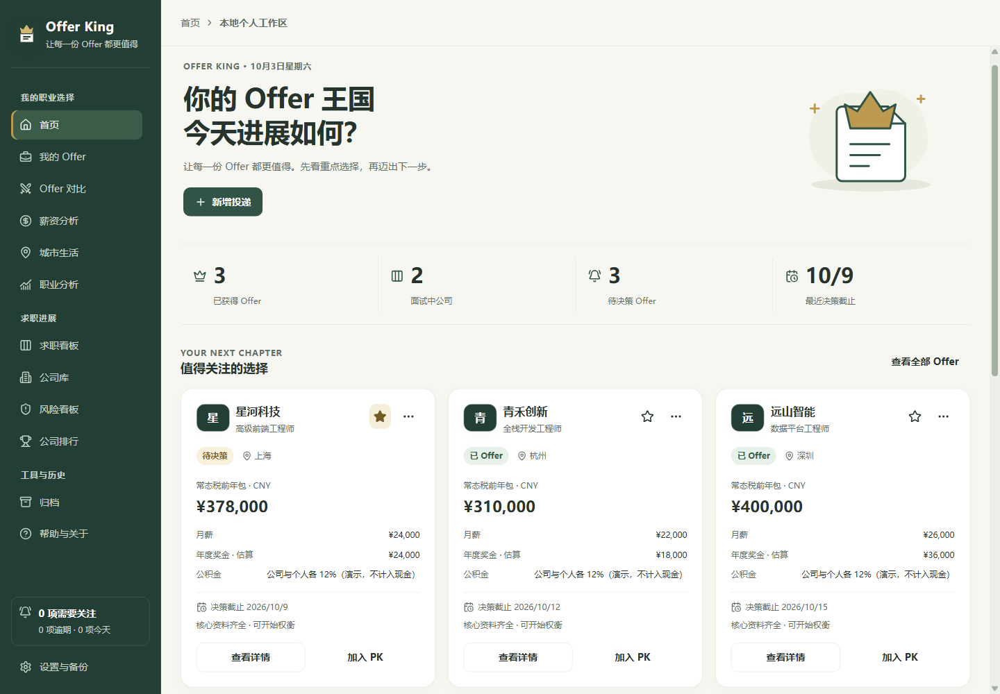
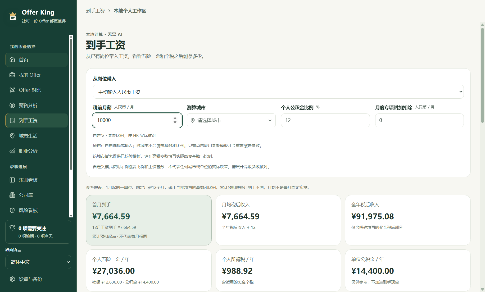
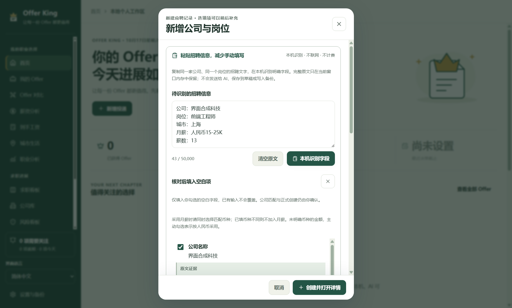

# Offer King

### 把投递进度记清楚，把 Offer 选择想明白。

面向个人求职的本地助手：跟进面试，比较待遇，算好换城市后的生活预算。现提供 Windows 与安卓候选试用包。

**Windows x64 / Android 开发试用 · 四种界面语言 · 本机保存 · 无需应用账号 · AI 可选**

[简体中文](README.md) · [English](docs/i18n/en/README.md) · [日本語](docs/i18n/ja/README.md) · [한국어](docs/i18n/ko/README.md)

**[↓ Windows 2.5.4 试用包](https://github.com/YCC-Lover/Offer-King/releases/download/v2.5.4/Offer-King-Setup-2.5.4.exe)**　·　**[↓ 安卓试用 APK](https://github.com/YCC-Lover/Offer-King/releases/download/v2.5.4/Offer-King-2.5.4-android-trial.apk)**　·　[下载与校验](docs/DOWNLOAD.md)　·　[文档中心](docs/README.md)

[界面预览](#界面预览) · [下载与版本](#下载与版本) · [快速开始](#快速开始) · [AI 配置](#ai-配置) · [常见问题](#常见问题) · [反馈与参与](#反馈与参与)

> [!IMPORTANT]
> **2.5.4 为候选试用版（Pre-release），不是已验收正式版。** Windows 未正式签名（NotSigned），安卓使用开发测试签名。真实 Windows 首装、覆盖安装和卸载，以及安卓真机安装、覆盖与使用尚未验收。升级前先导出 JSON；签名冲突不要直接卸载，不要关闭安全防护。[查看实际验证与未测事项](docs/RELEASE-2.5.4.md#已验证与尚未验收)

*点击图片浏览功能导览。上图为 2.0.0 实际应用的合成演示资料，首次使用从空白记录开始。[截图来源](docs/images/README.md)*

## 符合你的求职节奏

- **同时跟进多家公司：** 用阶段看板整理投递、笔试和面试，给每个岗位留下下一事项与时间。
- **招聘介绍不想再抄一遍：** 粘贴一份招聘文字，在本机识别明确字段，预览后填入空白项；无需配置 AI，不联网、不计费。
- **两份待遇各有吸引力：** 分开看常态年包和首年总包，用双 Offer PK 记录自己的权重与理由。
- **税前月薪究竟能到手多少：** 从岗位带入人民币月薪，自选城市、社保公积金基数与比例，查看 12 个月个税及到手估算；不改原岗位工资。
- **换城市前想算清生活成本：** 输入自己的租房、通勤和日常预算，再比较预计现金储蓄。

本地记录、看板、比较和备份无需 AI 或应用账号。可在 Windows 上持续整理资料，也可自愿尝试本版安卓开发包；手机实际兼容性仍待测试。各设备独立保存，没有云同步或多人协作。

## 2.5.4：试用更清楚，Windows 更新有入口

- **两个试用下载：** Windows x64 安装包与安卓 Debug APK；关于页顶部显示“小范围试用版”，不设到期时间，不人为限制本地功能。
- **Windows 新版提醒：** 启动及使用期间每天最多自动检查一次，支持手动检查、关闭和忽略；只打开官方发布页，不自动下载或安装。2.4.0 及更早用户需先手动升级一次。
- **安卓原生适配：** 本机记录、备份与原生安全配置、附件、AI、官网图标已有构建，未将编译通过表述为手机验收通过。Debug 包不作为正式自动升级资产推荐。
- **AI 继续可选：** 用自己的密钥，普通模型与搜索分开配置；先看证据、采纳到草稿，再明确保存。[新版说明](docs/RELEASE-2.5.4.md) · [AI 指南](docs/AI-SETUP.md)

## 界面预览

### 2.4.0：招聘文字少抄一遍，到手工资算清一点

从岗位带入工资，按自己的城市、基数与比例试算。结果是中国大陆人民币参考，不代表某城市统一缴费政策或 HR 实发承诺。

<strong>查看本机粘贴识别预览</strong>

在新增岗位时识别明确字段，先核对证据再填空白项。无需 AI、网络或模型密钥；完整原文不进入草稿和备份，只有你采纳的字段可保存。

*以上两图为 2.4.0 实际程序在独立测试目录中的合成演示，非真实求职资料；工资使用示例参数，不是安装器或报税验收。[截图来源](docs/images/README.md)*

### 跟进投递：每家公司走到哪一步，一眼找到

拖动卡片或选择阶段，打开详情查看流程。同一家公司可关联多个岗位，进度分别记录。全部待办覆盖逾期、今天、未来七天、以后和待安排时间。[查看跟进功能 →](docs/FEATURES.md#1-投递跟进下一步始终有着落)

### 双 Offer PK：把个人取舍放到明面上

待遇、成长、工作生活和个人偏好一起比较；缺少资料会提示补充。得分反映你填写的条件与权重，不代表企业客观排名。[了解比较口径 →](docs/FEATURES.md#2-待遇决策把数字和个人偏好分清楚)

<strong>展开看城市预算、深色界面与更多功能</strong>

预算来自你填写的税后现金与生活成本，不是实时城市均价或自动个税计算。

浅色、深色、跟随系统与 90%–125% 字号可按习惯调整。公司库、个人排行、带来源的风险看板和薪资分析也在[完整功能导览](docs/FEATURES.md)中。

*以上界面均来自 2.0.0 实际应用，金额、公司和评分为虚构演示数据。[版本及取景说明](docs/images/README.md)*

### 四语界面：用自己熟悉的语言管理求职

2.3.0 可在侧栏或显示设置中即时选择简体中文、English、日本語、한국어。正在编辑的内容会保留，公司、岗位和个人备注保持原文。

[英语首页实拍](docs/images/17-english-ui.png) · [日本語ホーム](docs/images/18-japanese-ui.png) · [한국어 홈](docs/images/19-korean-ui.png) · [四语使用指南](docs/README.md)

*以上多语言图来自 2.3.0 打包候选程序的独立合成环境，1400 × 900、100% 字号，采集时阻断外网；不是翻译重绘图，也不代表真实安装器已经验收。[截图来源](docs/images/README.md)*

## 下载与版本

**当前候选：2.5.4 · Windows x64 + Android 开发试用 · 中／英／日／韩界面。**

- [Windows 安装包 .exe](https://github.com/YCC-Lover/Offer-King/releases/download/v2.5.4/Offer-King-Setup-2.5.4.exe)：112,083,805 字节，未正式签名。
- [安卓试用 APK](https://github.com/YCC-Lover/Offer-King/releases/download/v2.5.4/Offer-King-2.5.4-android-trial.apk)：33,702,975 字节，Debug 签名，未做真机验收。
- [校验清单](https://github.com/YCC-Lover/Offer-King/releases/download/v2.5.4/SHA256SUMS.txt) · [离线指南](https://github.com/YCC-Lover/Offer-King/releases/download/v2.5.4/START-HERE.md) · [实际测试范围](https://github.com/YCC-Lover/Offer-King/releases/download/v2.5.4/TEST-RESULTS.json)

完整系统要求、备份顺序、签名限制和 SHA-256 见 **[下载中心](docs/DOWNLOAD.md)**。Latest 可能仍指向旧正式标记，请使用固定 v2.5.4 链接；`Source code` ZIP 只是公开文档，不是安装包。暂不提供 Mac／iOS／Linux 安装包。

继续保留本机招聘文字识别、到手工资、公司风险与排行、全部待办、草稿恢复、AI 原文提取、Offer 对比及城市预算。现有截图按原版本标注，不冒充安卓或本轮安装实拍。

[2.5.4 新功能与未验收事项](docs/RELEASE-2.5.4.md) · [全部更新记录](CHANGELOG.md)

## 快速开始

1. **下载并校验。** 从[下载中心](docs/DOWNLOAD.md)取得安装包，核对校验值。无需 GitHub 账号或开发工具；候选版的安装验收状态见上方说明。
2. **选好语言，再记一条投递。** 从侧栏或显示设置选择界面语言；可先粘贴招聘文字，本机预览识别后填入空白项，再核对公司、岗位、城市和阶段。不确定的资料以后再补。[图文操作 →](docs/QUICKSTART.md#2-建立第一条投递)
3. **按需要补充比较。** 收到待遇信息后，再填薪酬、城市预算和个人评分。定期导出 JSON，并另存附件原文件。[备份方法 →](docs/QUICKSTART.md#8-做好备份再慢慢完善)

已有旧版资料时，先备份再更新；安装后核对自己的记录。朋友各自从空白数据开始，使用自己的 AI 配置。

## AI 配置

- **本地管理与比较：** 无需 AI 配置，下载后即可开始录入。
- **本机识别与工资试算：** 2.4.0 两项新增功能不调用 AI，不需要模型或搜索密钥。
- **提取招聘原文：** [配置岗位模型](docs/AI-SETUP.md#4-配置自己的模型)，或使用已准备好模型的本机 Ollama；不要求搜索密钥。
- **联网查公开资料：** [配置模型与搜索](docs/AI-SETUP.md)；支持免费起步预设、自定义模型及原有提供商路线。

安装包**没有内置共享 API Key**。免费起步需要自己的 OpenRouter／Tavily 账号与密钥，额度和可用性由服务商决定；模型、搜索及连接检查可能消耗额度。

AI 建议先核对、再保存。“创建岗位后自动调研”默认关闭，主动启用后才会在新岗位创建成功时调用。粘贴原文提取不等于联网核实。[AI 操作、费用与隐私边界 →](docs/AI-SETUP.md)

## 常见问题

<strong>发布新版后，已经安装的 App 会自动提醒或升级吗？</strong>

Windows 2.5.4 已提供前台新版检查，自动检查每天最多一次，可关闭或手动触发，只打开固定官方发布页，不自动下载安装。2.4.0 及更早版本需先手动升级一次，发布 Release 不会给旧 App 自动添加能力。安卓 Debug 包不作为正式升级资产推荐；GitHub Watch 通知也不等于 App 内提醒。[更新说明](docs/DOWNLOAD.md)

<strong>怎样选择英语、日语或韩语？会影响我的记录吗？</strong>

2.3.0 在侧栏和“设置与备份 → 显示与可读性”提供四种语言。切换立即生效，不需要重启，正在输入的内容也会保留。仅翻译应用界面；公司名、岗位名、备注、人工阶段名和已有 AI 调研原文保持原样。语言偏好只存在本机界面设置中，不进入求职 JSON 备份。已有 2.2.0 安装包仍是中文界面。

<strong>不配置 AI，能正常使用吗？</strong>

可以。本地投递记录、流程、待办、薪酬比较、个人预算和备份不要求 AI。提醒只在 App 内显示，不是关闭 App 后运行的系统闹钟。

<strong>“免费 AI 起步”是否代表永久免费？</strong>

不代表。你需要自己的服务商账号与密钥，免费额度和模型可用性可能变化；也可配置自己已有的兼容模型或本机 Ollama。联网查询还需要对应搜索能力，模型连接成功不等于搜索可用。取消请求不能撤销服务商已处理部分的计费。[配置指南](docs/AI-SETUP.md)

<strong>资料保存在什么地方，朋友会看到我的记录吗？</strong>

资料保存在各自设备，安装包不包含作者的求职记录或密钥，目前没有云同步与遥测。分享安装包或项目链接即可，不要分享个人资料目录。

API Key 在本机加密，不进入求职 JSON 备份。普通记录、恢复草稿和备份不是加密保险箱；Windows 附件记录路径，安卓记录系统文档授权关联，不复制正文。备份不包含附件原文件，换设备后需重新选择。本机自动备份和恢复草稿也不能代替独立保管的正式备份。

公司官网图标与主动 AI 功能可能联网。云端原文提取会发送粘贴文字，完整原文只在窗口内存保留，**已采纳字段与有限证据摘录可进入草稿、记录和备份**；提交前请移除敏感内容。[数据与隐私](docs/PRIVACY.md)

<strong>支持手机、macOS、Linux 或自动更新吗？</strong>

本版提供 Windows 10 / 11 x64 安装包与安卓开发试用 APK，均为候选。暂无 macOS、iOS 或 Linux 安装包。Windows 有可选新版提醒，但不自动安装；安卓签名与真机边界请看下载中心。后续方向见 [ROADMAP](ROADMAP.md)，不代表上线承诺。

[更多常见问题 →](docs/FAQ.md) · [完整文档 →](docs/README.md)

## 反馈与参与

使用中卡住了，或发现“这里还可以更方便”，都欢迎反馈。请写清版本、操作步骤、期望和实际结果；页面问题可补充字号、主题和系统缩放。

[报告问题](https://github.com/YCC-Lover/Offer-King/issues/new?template=bug_report.yml) · [功能建议](https://github.com/YCC-Lover/Offer-King/issues/new?template=feature_request.yml) · [文档纠错](https://github.com/YCC-Lover/Offer-King/issues/new?template=docs_feedback.yml) · [私密安全反馈](SECURITY.md)

Issues 对所有人公开。请先打码，不要上传密钥、完整求职备份、真实附件或含私人路径的日志。[反馈指南](CONTRIBUTING.md)

觉得有帮助，欢迎 Star 收藏或把[项目主页](https://github.com/YCC-Lover/Offer-King)分享给求职中的朋友；想收到版本消息，可在 GitHub Watch 中订阅 Releases。

---

[文档中心](docs/README.md) · [所有版本](https://github.com/YCC-Lover/Offer-King/releases) · [后续方向](ROADMAP.md) · [使用许可](LICENSE.md) · [第三方声明](THIRD-PARTY-NOTICES.txt)

本仓库提供安装包入口、说明文档和反馈渠道。**Offer King 为闭源软件，应用源码不在本仓库公开。** 当前候选版 2.5.4；文档更新：2026-10-19。
