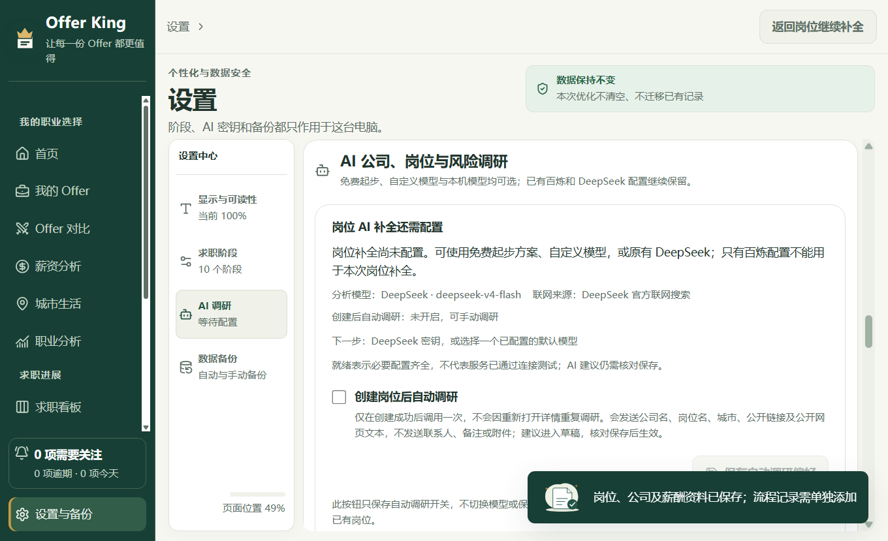
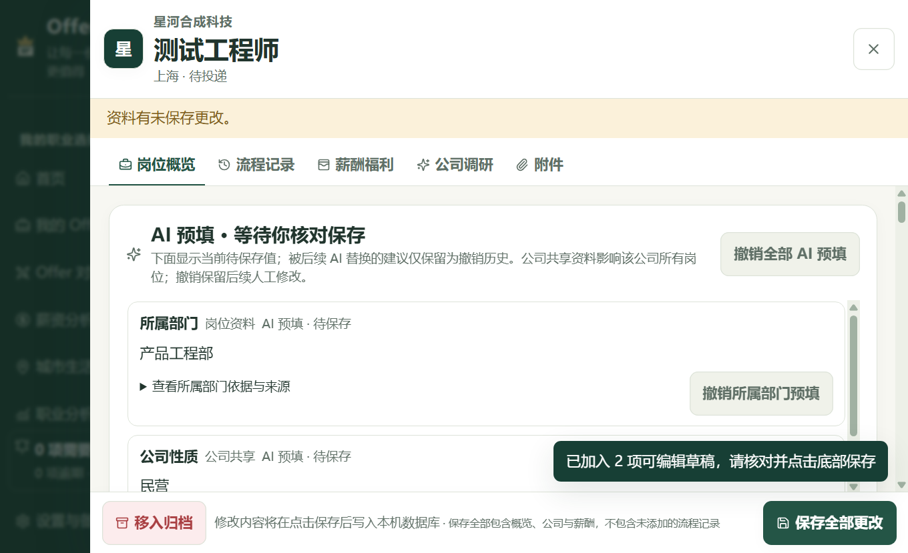

# Offer King 录入方式与 AI 配置指南

[简体中文](AI-SETUP.md) · [English](i18n/en/AI-SETUP.md) · [日本語](i18n/ja/AI-SETUP.md) · [한국어](i18n/ko/AI-SETUP.md)

[返回首页](../README.md) · [文档中心](README.md) · [下载安装与上手](QUICKSTART.md) · [常见问题](FAQ.md) · [数据与隐私](PRIVACY.md)

不配置 AI，也能记录投递、跟进面试、比较 Offer、备份，以及使用本机招聘信息识别与到手工资。**先选择适合的路线，不必为了减少录入就申请密钥。** 本指南不需要编程知识。

**2.6.0 新增的快速查找、看板／列表切换、组合筛选、保存视图和快速跟进也都不需要 AI。** 点击顶部“快速查找”（Windows 可用 `Ctrl+K`）查找本地公司、岗位或页面；在看板集中筛选记录；在“快速跟进”中明确保存下一事项和时间。这些操作不会因使用了新入口而调用模型，既有 AI 配置与自动调研开关继续沿用。

> 当前为 **安卓 2.6.1、Windows 2.6.0 候选试用版**（Pre-release，不标记为 Latest），提供四语界面，无试用期限或额外功能锁。Windows 安装包未正式签名；Android APK 使用开发测试签名。**真实 Windows 首装／覆盖／卸载与 Android 真机首装／覆盖安装尚未验收**，不能把编译、浏览器触控模拟或解包程序升级测试当成真实安装通过。[按平台下载与校验](DOWNLOAD.md)

**2.6.1 只为安卓补齐试用包新版提醒并改善更新卡片可读性，AI 功能、任务路由和已有配置保持原有策略。** 正常覆盖升级设计为保留原 AI 配置；不要为升级清除数据、重置密钥或重新填写已保存配置。更新检查只访问官方 GitHub 版本信息，不调用模型或读取密钥；真机覆盖后的 Keystore 可用性仍待验收。

### 先确认你使用的平台

| 平台 | 本轮文件与验证边界 | AI 配置差异 |
| --- | --- | --- |
| Windows 10/11 x64 | `Offer-King-Setup-2.6.0.exe`；已验证打包程序运行与隔离合成数据升级，不等于安装器首装／覆盖／卸载验收 | 云端兼容模型、OpenRouter＋Tavily、原有百炼／DeepSeek及本机 Ollama 路由已接入；密钥由 Electron 安全存储加密 |
| Android | [`Offer-King-2.6.1-android-trial.apk`](https://github.com/YCC-Lover/Offer-King/releases/download/v2.6.1/Offer-King-2.6.1-android-trial.apk)；开发测试签名，构建、验签和模拟检查通过；真机首装／覆盖与 AI 全流程未验收 | 原生已接入模型连接／列表、原文提取、公司／岗位／风险调研；沿用 Android Keystore 配置，升级后可用性待真机确认；Ollama 回环地址指手机自身，不是电脑 |
| macOS / iPhone / iPad | 本轮没有可下载的安装包 | 不应把源码或模拟测试视为可直接安装、已验收的版本 |

首次安装、尚未导入备份的新用户从各自的空数据开始；升级不会主动清空已有记录。没有云同步，也不附带作者的账户、记录或密钥。安卓 2.6.1 沿用 2.6.0 的应用身份、开发测试签名及存储配置；先导出 JSON、另存附件原文件，再在 APK 安装界面选择“更新”，不卸载、不清除数据。若提示签名不一致，停止并反馈。JSON 不包含 API Key 或附件文件本身，不能代替加密配置的原位保留。发布页的 `START-HERE.md`、`SHA256SUMS.txt` 和 `TEST-RESULTS.json` 分别说明上手、文件校验与已测／未测范围。

**语言与 AI 配置分开：** 侧栏或“设置与备份 → 显示与可读性”可即时切换简体中文、英语、日语、韩语，并保留正在编辑的内容。公司、岗位、备注、人工阶段名称与已有 AI 原文不自动翻译。切换语言不切换模型、搜索路线或密钥，也不代表同意任何新的收费调用。安装包仍不包含共享免费密钥。

**阅读路线：** [先分清三条路线](#先分清本机规则ai-原文还是联网查询) → 只需规则识别则[直接使用](#本机规则识别无需配置-ai)；需要模型才继续[选择配置入口](#选择配置入口) → 保存并明确启用 → 测试 → 核对后保存。

[本机规则识别](#本机规则识别无需配置-ai) · [免费起步](#2-新用户免费-ai-起步) · [联网补全操作](#3-创建岗位后核对补全) · [AI 原文提取](#新方式粘贴招聘原文) · [自定义模型](#4-配置自己的模型) · [一键检查](#ai-一键检查先保存再检查实际岗位路线) · [旧配置与任务分配](#5-旧用户与按任务选择模型) · [排查问题](#6-常见问题与安全边界)

## 1. 先选适合自己的方式

### 先分清：本机规则、AI 原文，还是联网查询？

| 路线 | 在哪里使用 | 配置、网络与费用 | 结果如何落地 |
| --- | --- | --- | --- |
| **本机规则识别** | 新建岗位 →“粘贴招聘信息，减少手动填写” | 无需模型、密钥、网络或费用 | 规则提取明确字段，预览后只填选中的空白项，已有输入不覆盖，再由你创建 |
| **AI 原文提取** | 岗位详情 →“粘贴招聘原文” | 需要已保存的岗位模型；不搜索、不需要 Tavily，但云端模型会收到原文，可能计费 | 所有建议默认不选，核对原文证据后加入草稿，再明确保存 |
| **AI 联网补全** | 岗位详情 →“开始联网补全”，或明确启用后的新建自动调研 | 兼容模型＋自己的 Tavily 配置，或原有 DeepSeek Pro 岗位策略；需要网络，可能计费 | 获取公开资料与来源，保护已有值，核对后保存 |

三条路线都不会替你推测未知薪资、待遇或个人求职状态。本机规则不是 AI，也不核实真假；AI 原文提取不是联网核实；联网资料即使有来源，也需判断是否属于同一家公司、岗位和城市。普通模型不会因为填入了 API Key 就自动拥有搜索能力。公司官网图标和版本检查属于独立网络功能，不代表使用本机规则时整个 App 不会访问任何网站。

只想把明确文字填进新建表单，先试本机规则。希望模型理解复杂原文时，再配置并启用岗位模型，无需为该提取任务另外申请搜索服务。**不要把免费本机识别与可能收费的云端原文提取混用。**

### 本机规则识别：无需配置 AI

1. 打开新建岗位，展开“粘贴招聘信息，减少手动填写”。
2. 粘贴同一家公司、同一岗位的招聘文字，点击“本机识别字段”；不要混贴多个公司或岗位。
3. 核对建议值和原文证据，特别是币种、月薪区间与薪数。未知内容不猜填，币种不明确的金额不要直接采纳。
4. 勾选想采用的空白字段，点击“填入 … 项空白字段”。已有输入保留，不静默覆盖或合并同名公司。
5. 在可编辑表单继续核对，公司复用、字段修改与正式创建仍由你确认。

本机规则不调用 AI、不搜索、不访问原文里的链接、不计费，也不会自动打开云端请求。完整原文只在当前窗口内存中保留，不写入恢复草稿或备份；明确创建后的字段正常存入记录。规则可能识别不到复杂表达，可手动补齐，或另选下方 AI 路线。到手工资同样是本机计算，不用在这里配置任何模型。[工资试算说明](QUICKSTART.md#到手工资先核对缴费参数再看结果)

### 选择配置入口

| 你的情况 | 建议从哪里开始 | 需要准备 |
| --- | --- | --- |
| 只是想少填明确招聘字段 | [本机规则识别](#本机规则识别无需配置-ai) | 无需服务账户、密钥或模型 |
| 第一次接触 API，想联网查资料 | [“免费 AI 起步”](#2-新用户免费-ai-起步) | 自己的 OpenRouter 模型密钥、Tavily 搜索密钥 |
| 只想提取原文，或已有其他模型 API | [“我的模型配置 → 新增模型配置”](#4-配置自己的模型) | 兼容接口地址、准确模型名、自己的密钥；只有联网调研另需 Tavily |
| 电脑已安装本机 Ollama | [“Ollama 本机模型”](#使用本机-ollama) | 运行中的本机服务、已下载模型；仅原文提取不需要搜索，联网调研仍需 Tavily |
| 已经配好百炼／DeepSeek | [“原有官方提供商”](#5-旧用户与按任务选择模型) | 可保留原配置；原有岗位任务需要 DeepSeek，仅有百炼不能提取岗位原文 |

API Key 可以理解为服务商账户的访问凭证，不是普通登录密码。**每个人使用自己的密钥，不要发给作者、朋友或公开 Issue。** 安装包不附带共享 Key，也没有安装即用、无限免费的云端 AI。

**配置成功的标志不是“填过密钥”，而是实际任务已启用正确配置。** 只做原文提取，可单独测试岗位模型；要联网补全，再检查搜索能力。模型、搜索和测试都可能消耗额度，请先确认服务商计费设置。

## 2. 新用户：免费 AI 起步

截图来自 2.1.1 隔离测试环境，显示未配置状态，不含真实密钥。

### 申请两把自己的密钥

1. 打开 **设置与备份 → AI 调研 → 免费 AI 起步**。
2. 点击“申请 OpenRouter 密钥”，在 [OpenRouter 密钥页](https://openrouter.ai/settings/keys) 注册／登录自己的账户并创建密钥，填入“OpenRouter 免费模型 API Key”。
3. 点击“申请 Tavily 密钥”，在 [Tavily 控制台](https://app.tavily.com/home) 注册／登录并取得搜索密钥，填入“免费起步 Tavily API Key”。
4. 如果只想使用免费额度，请在服务商账户中确认免费计划、剩余额度和按量付费设置；不要仅凭 App 中的“免费”字样判断账户不会收费。

预设分析模型是 `openrouter/free`，基础地址为 `https://openrouter.ai/api/v1`。应用为这个免费预设附加零价格提供方限制，不自动改用付费模型。OpenRouter 会从可用免费模型中选择，具体模型和服务可用性可能变化；忙时可能变慢或限流。[OpenRouter 免费路由说明](https://openrouter.ai/docs/guides/routing/routers/free-router)

Tavily 提供公开网页搜索与来源，不是另一套聊天模型。在使用 Tavily 的配置路线中，本应用每轮调研最多发起一次 `basic` 搜索，不自动升级搜索深度；候选来源继续分析会复用仍有效的证据，不重新搜索。搜索额度与模型额度分开。服务商提供免费积分，也有付费方案；当前额度与账户计费请查看 [Tavily 官方说明](https://docs.tavily.com/documentation/api-credits)。本指南不承诺固定额度或永久免费。

### 保存、测试，再决定是否自动调研

1. 点击 **“保存并启用免费配置”**。这会把公司综合调研、岗位联网补全、公司风险调研三项都切换到免费配置，并保存页面顶部的自动调研开关；保存本身不会立即发起调研。
2. 在 **“AI 一键检查”** 确认实际岗位模型与搜索服务，勾选费用同意后点击“一键检查岗位补全”；也可分别点击“测试免费模型”和“测试搜索”。测试会访问对应服务并可能消耗额度。
3. 看页面顶部的“分析模型”“联网来源”和配置提示。**配置齐全不等于已经通过测试；模型能连接，也不等于结构化分析和搜索都能成功。**
4. 想让以后新增的投递自动补全，再勾选顶部 **“创建岗位后自动调研”**，点击 **“保存自动调研偏好”**。默认关闭；不开启也可手动调研。此按钮只保存开关，不切换模型。

配置完成后起步教程会收起，需要修改时点击“查看起步教程与密钥”。免费服务额度不足或失败时，应用不会静默改用收费模型；但应用不能替你关闭服务商账户中已开启的付费设置。

## 3. 创建岗位后，核对补全

此图为模拟 AI 响应与演示资料，仅说明操作流程，不代表服务商实测或真实公司信息。

1. 点击“新增投递”，填写公司名和岗位名；建议同时填写城市，以及准确的公司官网／岗位链接，减少同名公司和不同招聘版本的混淆。
2. 点击“创建并打开详情”。**基础投递先保存，AI 后调研**：启用自动调研时才会在创建成功后调用一次，输入过程中不调用。不开启时，点击岗位详情中的“开始联网补全”。
3. 等待公开资料读取、联网检索、分析与校验。自动预填只针对有来源与原文证据支持的空白字段；已有值和你刚手动填写的内容受到保护。
4. 查看 **“AI 预填 · 等待你核对保存”**：核对当前待保存值、证据、来源和人工修改标识。薪资、学历、经验等不明确信息不应凭猜测填入。
5. 尚未采纳的建议按“岗位资料、薪酬福利、公司共享资料”展示。先核对来源，再选择需要的项并点 **“加入可编辑草稿”**；与当前资料冲突的建议默认不选。公司共享资料会影响同一公司的其他岗位。
6. 确认后点击底部 **“保存全部更改”**，才写入正式资料，并记录实际采纳字段、来源、模型与查询时间。未添加的流程记录仍需单独添加。

阶段、优先级、联系人、下一事项、提醒、面试结果和个人备注由你维护，不由 AI 自动推测修改。AI 结果只是辅助信息，即使带有来源也应核实是否适用于这家公司的这个岗位。

几个容易混淆的操作：

- **切换详情标签**：不会丢掉当前补全建议，可以来回核对岗位和薪酬。
- **“关闭建议（保留草稿）”**：只收起当前预览，已经填入的草稿还在，不代表撤销。
- **“撤销全部 AI 预填”／逐项撤销**：撤销对应预填，保留后来手动改过的内容；已正式保存的数据不等于可用草稿撤销恢复。
- **“配置 AI”→“返回岗位继续补全”**：可从详情前往设置并回到同一岗位，离开先保护未保存内容；返回本身不会重新发起调用。
- **多个匹配来源**：先点“查看原网页”，确认公司、岗位和城市后点“使用此来源继续调研”。选择复用首轮证据，不再做一次搜索；候选超过五分钟、应用重启或配置改变后，需要主动重新调研。

普通重开旧岗位不会自动调研。AI 失败也不会删除已创建记录；修正信息或配置后可手动重试。

### 新方式：粘贴招聘原文

招聘页面需要登录或无法读取时，可以自行复制有权使用的招聘介绍，不必为了提取而配置搜索密钥。

1. 创建并打开岗位详情，在 AI 面板选择 **“粘贴招聘原文”**，核对实际分析模型。
2. 粘贴同一家公司、同一个岗位的介绍，最多 **50,000 字符**。先删除姓名、手机号、邮箱、简历内容及其他不应交给模型的资料。
3. 阅读并勾选隐私与费用说明，点击 **“提取招聘原文”**。只调用已保存的岗位模型，不调用 Tavily，不打开文字里的网址，不自动改用其他服务。
4. 对照当前值、建议值和原文证据摘录。**全部建议默认不选**，确认后主动勾选并点击 **“加入可编辑草稿”**。
5. 可以继续修改或撤销；最后点击岗位详情底部的保存按钮，才写入正式记录。关闭建议不会自动撤销已加入的草稿，也不会自动保存。

仅建议有原文证据的岗位与薪酬字段，不猜未知薪资、薪数、学历、经验或福利，不生成公司共享资料或风险评估。原有岗位路线只使用 DeepSeek；只有百炼配置无法执行此任务。兼容模型及本机 Ollama 按当前岗位选定配置执行。

结果明确标记 **“用户提供招聘原文，未经联网核实”**，不代表信息真实有效或雇主承诺。完整原文仅在当前窗口内存中保留，离开会提示清除；异常退出不会恢复全文。**已采纳字段及有限证据摘录可以随草稿保留**，正式保存后的字段与来源元数据可进入记录和 JSON 备份。

## 4. 配置自己的模型

在 **“我的模型配置 → 新增模型配置”** 中填写：

| 字段 | 怎么填 |
| --- | --- |
| 配置名称 | 自己能认出的名称，例如“我的工作模型” |
| 接口类型 | 按服务商文档选择 OpenAI 兼容 Chat Completions、Responses，或 Ollama 本机模型 |
| 接口基础地址 | 云端必须是服务商的公网 HTTPS 基础地址，不是聊天网页地址 |
| 模型名称 | 服务商给出的准确模型 ID，不是随便填写品牌名 |
| 自定义模型 API Key | 对应这个服务的密钥；本机 Ollama 不需要此项 |

可以点“读取模型列表”帮助选择；失败时仍可手动输入准确模型名。粘贴以 `/chat/completions`、`/responses` 或 `/models` 结尾的完整地址时，页面会显示识别出的基础地址，保存前请核对。

点击“保存模型配置”，再在模型卡上测试。**保存普通模型不等于启用它**：需要点击“设为默认并保存”，或在“默认模型与使用范围”选择后点“保存使用偏好”。“设为默认并保存”会保存当前使用偏好，已按任务单独指定的模型不会随默认值变化；请查看模型卡的实际使用范围。

更换接口地址或协议后，应填写新服务对应的密钥；同一服务仅改模型、密钥留空可保留原密钥。读取模型列表优先使用当前输入的新密钥但不会保存，模型卡测试使用已保存的配置。

**兼容协议不等于支持任意模型。** 服务和模型必须支持应用需要的结构化输出；仅有网页版聊天会员不等于已有 API 额度。请使用自己信任的服务商，确认其地址、数据处理规则和计费后再提交密钥。

### 普通模型还需要搜索配置

普通兼容模型和本机 Ollama 在本应用中由 Tavily 提供联网资料。进入 **“联网搜索 · Tavily”** 填自己的搜索密钥，点“保存搜索密钥”，再点“测试 Tavily 搜索”。只测试模型成功，不表示联网已可用。**仅使用“粘贴招聘原文”不需要 Tavily。**

### 使用本机 Ollama

在 Windows 上，自行安装并运行 Ollama，下载适合电脑性能的模型，选择“Ollama 本机模型”，默认地址为 `http://127.0.0.1:11434/v1`。本应用只连接本机回环地址，不自动安装环境或下载模型。接口能力可查阅 [Ollama 官方兼容说明](https://docs.ollama.com/api/openai-compatibility)。

**Android 的 `localhost`、`127.0.0.1` 或 `::1` 都指手机本身，不会连接你电脑上的 Ollama。** 当前不允许把电脑局域网地址填入此本机路线，也不随 APK 提供手机模型服务。没有准备好手机本机兼容服务时，请使用云端兼容模型，或先用无需 AI 的本机规则；不要把“配置已保存”当成服务正在运行。

想在本机推理时，请选择已下载的本地模型，不要把由本机服务转发的云模型误认为离线推理。即使使用本地模型，联网调研仍会访问公开页面及 Tavily，并消耗搜索额度。

### AI 一键检查：先保存，再检查实际岗位路线

这是 **岗位联网补全** 的检查，不是所有模型、公司调研与风险任务的一次性认证，也不会替你保存设置或切换服务。

1. 保存希望使用的模型、任务路由和搜索配置；检查不使用模型编辑器中未保存的内容。
2. 打开“AI 一键检查”，查看“分析模型”和“搜索服务”。配置缺失时，点击“检查本地配置”只做本地核对，不发送请求。
3. 配置齐全后，勾选 **“同意本次 AI 检查额度与费用”**，点击 **“一键检查岗位补全”**。
4. 依次查看 **已保存配置 → 连接与结构化输出 → 联网来源**。兼容模型检查 Tavily，原有 DeepSeek 路线检查其官方联网来源。失败即停止，不自动重试或切换模型。
5. 可点击“停止检查”；离开设置页也会停止。已经发出的请求仍可能计费，取消不能撤销服务商已处理的费用。

一次检查最多发送一次模型测试和一次对应搜索测试，使用固定测试文字，不使用你的求职记录。通过仅说明这一次连接、结构化输出与来源可用，不保证真实招聘网页能读取、信息准确或后续额度充足。检查过程中不能同时修改配置；只做原文提取时，在模型卡单独测试模型即可，不必补配搜索。

## 5. 旧用户与按任务选择模型

版本设计保留同一安装身份下的原有百炼／DeepSeek 配置，不替你切换模型；这不等于密钥能跨设备、跨系统迁移，也不等于真实覆盖安装已验收。升级前先备份。展开“原有官方提供商”可继续管理。没有主动改变使用范围时，保留原策略：

- 公司综合调研优先百炼联网；百炼不可用时可转为明确标注“非联网”的 DeepSeek 分析。
- 岗位联网补全、公司风险调研只使用 DeepSeek 官方 `/responses` 联网接口，不使用百炼兜底。**本版内置路由仅允许 `deepseek-v4-pro` 执行官方联网；默认的 `deepseek-v4-flash` 会提示不支持，应用不会自动换成 Pro。** 这是当前应用的路由限制，不表示本轮实测了服务商的全部最新能力。
- 粘贴岗位原文只需要分析模型，不联网、不调用 Tavily；原有路线可使用已配置的 DeepSeek Flash 或 Pro，仅有百炼不能执行此任务。

需要原有 DeepSeek 联网时，在“原有官方提供商 → DeepSeek”选择 `deepseek-v4-pro`，保存并测试，再确认岗位／风险任务仍选择原有策略。另一种选择是自定义兼容模型配合 Tavily；把 DeepSeek 添加成自定义模型也属于这条 Tavily 路线，不会自动继承原有配置的密钥或内置搜索。一次官方 Responses 请求可能在服务端执行多次搜索，不能把“一次点击”理解为固定一次费用。[DeepSeek Responses 文档](https://api-docs.deepseek.com/api/create-response/)

**旧模型名称可能变化：** 2.6.0 为保持已有配置保留 `deepseek-v4-flash` 选项；截至本指南更新日，DeepSeek 的 Responses 官方文档列出的 Flash 名称为 `deepseek-flash`。本轮没有使用真实账户验证旧 ID 是否仍可调用。若返回“模型不存在／不可用”，请核对服务商当前文档，再在“我的模型配置”新增兼容配置、填写有效模型名并测试；普通兼容路线联网仍需 Tavily。应用不会自动替你更换模型或升级收费方案。[DeepSeek 当前接口说明](https://api-docs.deepseek.com/api/create-response/)

Android 已实现上述路由；取消或模型／搜索超时会停止，不继续切换提供商。普通公司调研的 DeepSeek 兜底是**非联网分析**，不可当成最新事实或有来源的风险报告。

需要不同任务用不同模型时，展开 **“按任务分别指定模型（高级）”**：为公司、岗位、风险分别选择配置，或选择“使用原有百炼／DeepSeek 策略”，再保存。选择“跟随默认模型”可恢复统一配置。

已选新配置的任务失败时会提示，不会悄悄换到旧提供商或其他收费模型。免费起步的“保存并启用免费配置”是明确切换三项任务的操作，已有配置用户请先确认这一点。

## 6. 常见问题与安全边界

| 遇到的情况 | 先检查什么 |
| --- | --- |
| 显示未配置／模型保存了却没生效 | 查看实际任务路由及模型卡使用范围，保存模型后需明确启用 |
| 模型成功，联网失败 | 单独检查 Tavily 密钥、搜索测试和账户额度；旧策略则检查对应官方提供商 |
| DeepSeek Flash 能测试／提取原文，却不能联网 | 原有岗位／风险联网要求主动选 Pro；或改为自定义兼容模型＋Tavily，不会自动升价切换 |
| Android 连接不上电脑 Ollama | 手机回环地址不是电脑；此路线不接受局域网地址，可改用云端模型或无需 AI 的本机识别 |
| 鉴权失败、限流或余额不足 | 核对对应服务的密钥、模型权限、控制台额度与计费设置，勿公开 Key |
| 找不到来源／岗位内容不完整 | 补充城市、准确公开链接，或选择“粘贴招聘原文”；原文提取不等于联网核实 |
| 格式异常／不能分析 | 模型可能不支持所需结构化输出，查看服务文档，选择兼容模型后再测试 |
| 配置完成，却没有自动补全旧岗位 | 自动调研只作用于开启后新建成功的岗位；旧岗位需手动开始 |

“取消补全”会停止本机请求，取消后的结果不会继续自动采纳；已经被服务商处理的部分仍可能计费。关闭详情或切换记录会取消当前请求，切换同一详情的标签不会。Android 离开前台时也会停止当前及排队的 AI 网络任务；请保持应用在前台等待结果，不要期待后台继续完成。

联网调研只读取功能必需的公司／岗位身份字段和安全获取的公开文本，不主动读取联系人、个人备注、面试进度或附件内容。原文提取会把你主动粘贴的文字发给实际岗位模型；使用云端服务前必须自行去除敏感信息。也不要把敏感内容塞进公司名、岗位名、官网或招聘链接等调研字段。Windows 使用 Electron 安全存储，Android 使用 Android Keystore 加密密钥配置；模型和搜索密钥不进入求职数据库或 JSON 备份，重新换设备时需自己配置。普通记录、草稿与备份并非加密保险箱。详见 [数据与隐私](PRIVACY.md)。

本版使用模拟 AI 响应进行了自动化验证，尚未用专用真实凭据完成全部服务商端到端实测；Android 也尚未完成真机 AI、系统密钥存储、前后台切换和服务可达性验收。原生代码已接入这些功能不等于每款手机或每个模型都验证成功。实际网络可达性、模型输出质量和额度需自行测试。AI 失败不影响本地记录功能。

### 以后如何更新 App？

Windows 2.6.0 与安卓 2.6.1 在“帮助与关于 → 应用更新”提供“启动及使用期间自动检查（每天最多一次）”及手动检查，可关闭自动检查、选择是否包含候选版或忽略某版本。自动检查仅在应用前台使用时进行；只读取本项目官方 GitHub Release 元数据，找到更高版本且匹配平台的文件才提示，打开对应官方发布页。**不会自动下载或安装，也不读取 AI 密钥或调用模型。**

安卓 2.6.0 及更早试用包存在试用文件名匹配问题，需要先手动覆盖升级到 2.6.1 一次，之后才会识别未来更高版本官方试用 APK；提醒受候选开关与忽略设置控制。当前没有更高版本时显示无更新是正常情况。Windows 2.4.0 及更早公开用户也需先手动升级一次。GitHub Watch Releases 属于 GitHub／邮箱通知，不等于 App 内提醒。

下载前查看 [安卓 2.6.1 发布页](https://github.com/YCC-Lover/Offer-King/releases/tag/v2.6.1) 或 [Windows 2.6.0 发布页](https://github.com/YCC-Lover/Offer-King/releases/tag/v2.6.0) 的 `START-HERE.md` 和校验文件；先导出 JSON、另存附件原文件，覆盖后检查原记录与 AI 配置状态。不要关闭系统防护，也不要为解决签名冲突直接卸载旧版。**安卓真机首装、覆盖安装、浏览器交接及 Keystore 升级后可用性仍未验收。**

分享给朋友时，分享[按平台下载入口](DOWNLOAD.md)和指南，不分享自己的数据目录、备份或密钥。朋友从各自的空数据开始，并配置自己的服务；只用本机规则、到手工资或日常效率工具时不需要 AI 账户。

文档更新：2026-10-24，对应安卓 2.6.1 / Windows 2.6.0 候选试用版；AI 配置策略未因本轮更新而改变。第三方政策与额度以服务商当前说明为准。
