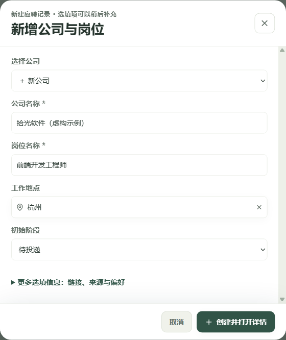
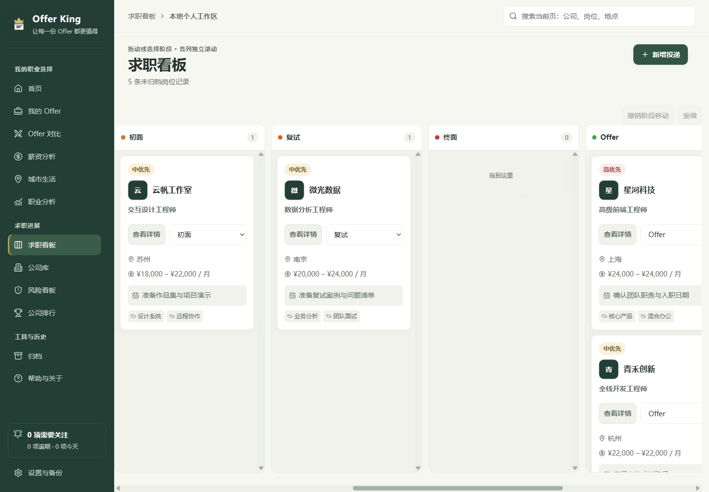
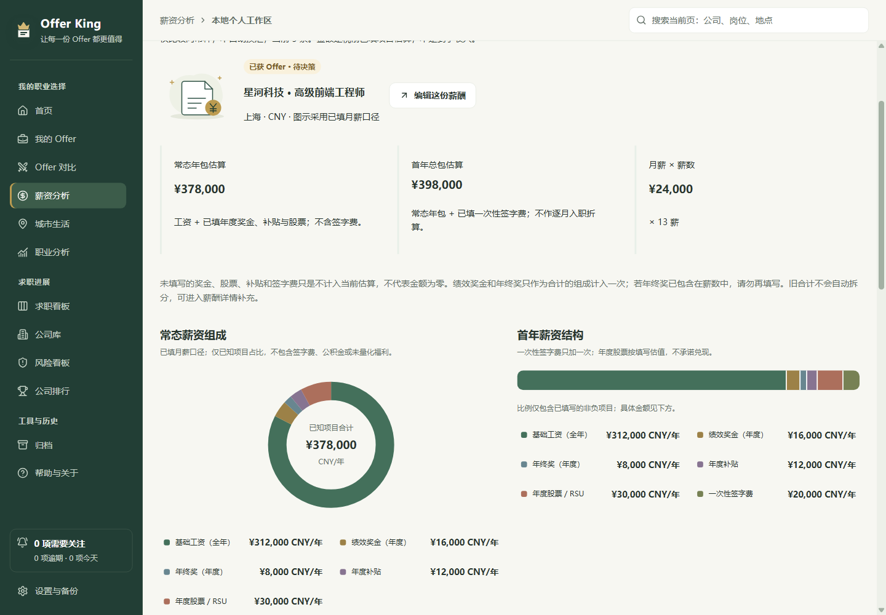
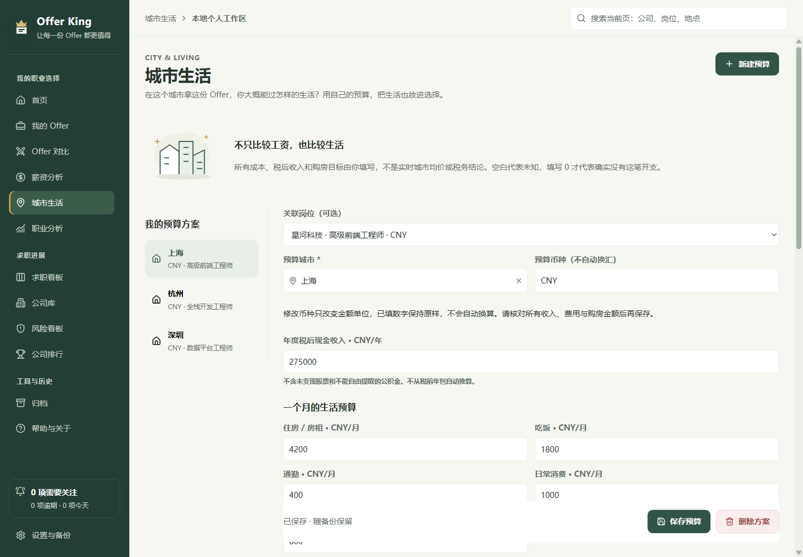
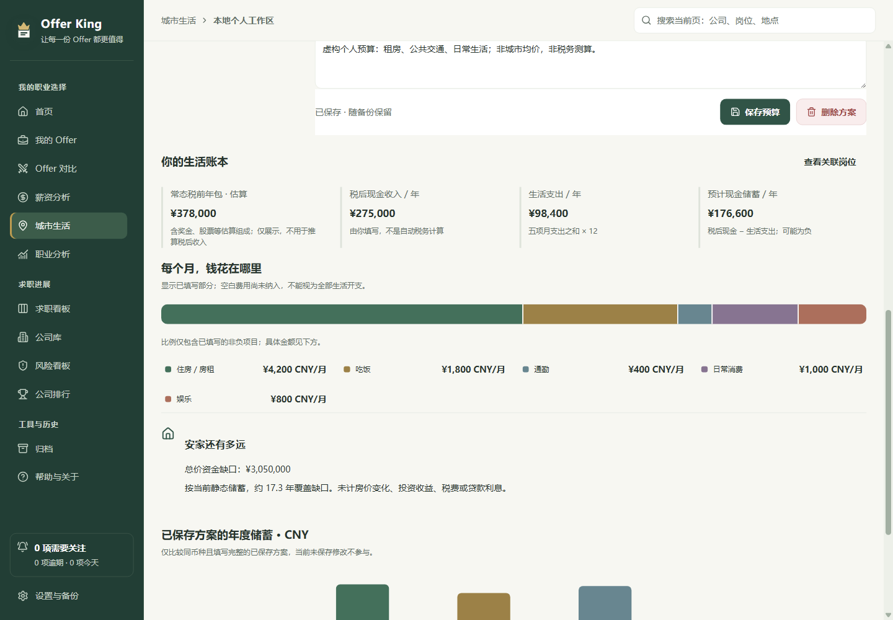
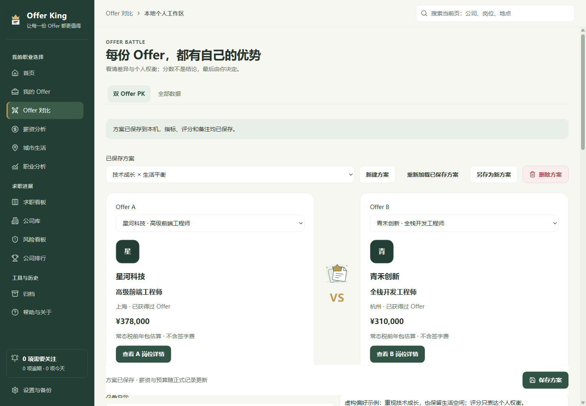
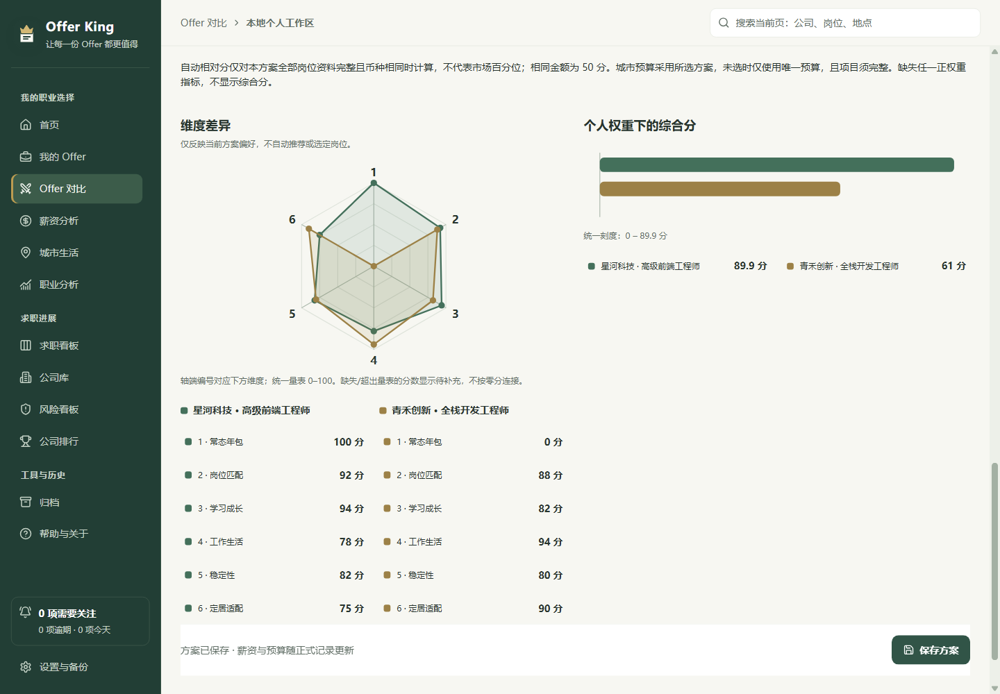
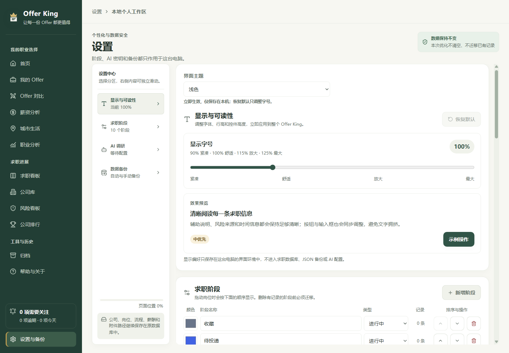
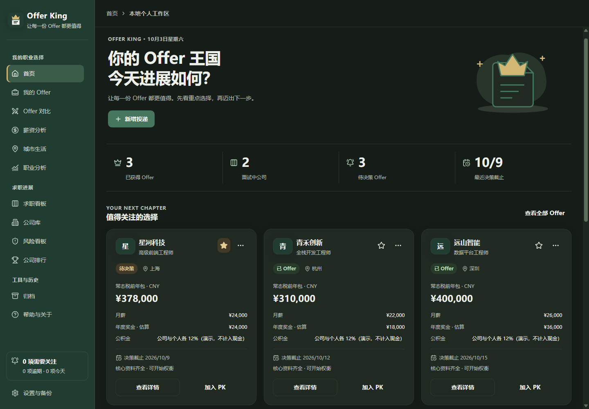

# Offer King 图文上手指南

[简体中文](../README.md) · [English](i18n/en/README.md) · [日本語](i18n/ja/README.md) · [한국어](i18n/ko/README.md)

[返回首页](../README.md) · [下载中心](DOWNLOAD.md) · [文档中心](README.md) · [功能导览](FEATURES.md) · [AI 配置指南](AI-SETUP.md) · [常见问题](FAQ.md) · [数据与隐私](PRIVACY.md)

从记录第一条投递开始，不需要一次把所有内容填完。本指南以 **Windows 2.6.0 候选试用版** 操作为主，并补充 **安卓 2.6.1** 更新方式。本页现有截图来自 2.0.0，使用演示数据，未展示本轮新增面板；新版 AI 设置以 [AI 配置指南](AI-SETUP.md) 为准。刚安装的应用会从你自己的空白记录开始。

> **真实干净 Windows 首装与覆盖安装尚未验收。** 这是未签名的候选试用包（Pre-release），不是安装验收完成的正式版本。升级前先导出备份，遇到系统拦截不要关闭安全防护。

## 1. 下载并安装

[直接下载 Windows 2.6.0 候选试用包](https://github.com/YCC-Lover/Offer-King/releases/download/v2.6.0/Offer-King-Setup-2.6.0.exe)，或打开 [2.6.0 发布页](https://github.com/YCC-Lover/Offer-King/releases/tag/v2.6.0)，在 **Assets** 中选择 `Offer-King-Setup-2.6.0.exe`、`SHA256SUMS.txt` 和 `START-HERE.md`。下载不需要 GitHub 账号；不需要下载 `Source code` 压缩包，也不需要安装开发工具。[历史 2.3.0](https://github.com/YCC-Lover/Offer-King/releases/tag/v2.3.0) 仍保留。

Windows 面向 Windows 10 / 11 x64，应用最小窗口为 1100 × 700。安卓请[下载 2.6.1 候选试用 APK](https://github.com/YCC-Lover/Offer-King/releases/download/v2.6.1/Offer-King-2.6.1-android-trial.apk)，并核对该发布页校验文件；它使用开发测试签名。**手机真机首装、覆盖安装和运行仍未验收**，窗口尺寸要求不适用于安卓。[安卓下载与签名边界](DOWNLOAD.md)

### 安装前先核对

本版安装包未进行数字签名，Windows 可能提示未知发布者。请确认来自上面的仓库，并核对文件校验值。不要关闭 Defender、SmartScreen 等安全防护；系统持续拦截时，请停止安装并 [报告问题](https://github.com/YCC-Lover/Offer-King/issues/new?template=bug_report.yml)。

在安装包所在文件夹打开 PowerShell，运行：

```powershell
Get-FileHash -Algorithm SHA256 -LiteralPath '.\Offer-King-Setup-2.6.0.exe'
```

2.6.0 这一份候选试用包的大小为 **112,107,822 字节（约 106.9 MiB）**，SHA-256 应为：

```text
495a394bc9fd565cf18120a469c3eda145463f2c52d32a0901028e492320fefe
```

哈希只能核对文件是否一致，不能代替可信来源与数字签名。其他版本应核对对应发布页，不能套用这个值。

确认接受候选试用范围后，按安装向导操作。真实首装、覆盖安装与卸载尚未执行；选择跳过验收不等于这些场景已经通过。如果出现异常，请保留现状，不要清空应用数据。详细范围见 [2.6.0 发布说明](RELEASE-2.6.0.md#已验证与尚未验收)。

安装成功后就可以新建投递，不必先注册或配置 AI。第一次打开没有演示公司的记录，也不会包含作者的数据；跟着第 2 步添加自己的第一条投递即可。想使用 AI 时，再配置自己的密钥并了解相应费用。

### 已经用过旧版？先备份

先在旧版“设置与备份”中导出 JSON，妥善保存，然后关闭旧版。更新时保留原安装位置，不要为了升级先清空数据或卸载。启动新版后，核对原来的公司、岗位与 AI 配置状态，并继续保留升级前的备份。

部分内部文件名仍沿用原名称，这是为保留原有数据兼容性；请不要自行改名或移动应用数据。

Windows 2.6.0 与安卓 2.6.1 可在“帮助与关于 → 应用更新”手动检查新版，也可前台每天最多自动检查一次，支持关闭、候选版开关与忽略；提示后由你打开官方发布页下载，不会自动安装。Windows 2.4.0 及更早公开版需先手动升级一次。GitHub 订阅不是 App 内提醒。

### 安卓 2.6.1：先手动更新一次，之后接收新版提醒

安卓 2.6.0 及更早试用包有文件名匹配问题，需要手动获取本次 APK。先导出 JSON 到自己控制的位置，并保管附件原文件；下载官方 2.6.1，打开安装界面选择“更新”，保留旧 App，不清除数据或重置 AI。2.6.1 沿用 2.6.0 的应用身份、开发测试签名和存储配置，设计为覆盖更新后保留记录与 AI 配置；签名冲突时停止，不直接卸载。JSON 不含密钥或附件文件本身。

打开新版后先核对旧记录与 AI 配置状态，再在“帮助与关于 → 应用更新”确认候选提醒已开启；当前没有更高版本时显示无更新是正常情况。**真机首装、覆盖安装、浏览器交接及 Keystore 升级后可用性尚未验收。** [本轮范围](RELEASE-2.6.1.md#已验证与尚未验收)

## 2. 建立第一条投递



1. 在欢迎页点击“新增第一条投递”；已有记录时，也可以在求职看板点击“新增投递”，或按 `Ctrl+N`。
2. 选择“＋ 新公司”，填写“公司名称”和“岗位名称”。例如：公司填“示例科技”，岗位填“产品经理”。
3. 按实际情况选择“工作地点”和“初始阶段”。公司官网、岗位链接和来源可以展开“更多选填信息：链接、来源与偏好”补充，也可以以后再填。
4. 点击“创建并打开详情”。

同一家公司有多个岗位时，直接在“选择公司”中复用已有公司即可，不必为每个岗位重复建公司档案。

**做完后检查：** 岗位详情能够打开，求职看板中也能找到对应卡片。这里不需要配置 AI。

### 少手填：先在本机识别招聘文字

在新建窗口展开 **“粘贴招聘信息，减少手动填写”**，粘贴同一家公司、同一岗位的文字，点击 **“本机识别字段”**。对照原文证据核对公司、岗位、城市、币种、月薪等建议，勾选后点击 **“填入 … 项空白字段”**。已有输入不覆盖，填入后仍可编辑，最后由你确认创建。

这个入口使用本机规则，不调用 AI、不联网、不计费；复杂格式可能识别不全，没有明确写出的内容不猜填。完整原文只留在当前窗口内存，不进入恢复草稿或备份；正式创建的字段会正常保存。它和岗位详情的 **AI“粘贴招聘原文”** 是两条路线，后者需要模型、会发送原文，可能收费。[三种方式怎么选](AI-SETUP.md#先分清本机规则ai-原文还是联网查询)

已配置 AI 且明确开启“创建岗位后自动调研”时，基础记录创建成功后才会调研一次。补全结果先进入可编辑草稿，**核对后仍需点击“保存全部更改”**；没有开启时，可在详情中手动点“开始联网补全”。AI 失败不会删除刚创建的投递。[完整操作说明](AI-SETUP.md#3-创建岗位后核对补全)

## 3. 让下一步有着落



在岗位详情中填写“下一事项”和提醒时间，例如“确认下一轮面试时间”，然后点击“保存全部更改”。回到首页，就能按逾期、今天和未来七天查看待办。

点击首页或侧栏的待办入口，打开 **“全部待办”**：逾期、今天、未来七天、以后、待安排时间五组均可查看。暂时不知道时间也能先记录事项；长列表可滚动到底，点击记录打开详情调整时间。已归档、已拒绝和已结束岗位默认不在提醒中；公司单独归档不会隐藏仍活跃的岗位事项。

面试有进展时，可以把看板卡片拖到对应阶段，也可以使用卡片上的阶段选择菜单。完成待办和推进阶段是两件事：“完成事项”会记录流程，但不会替你改变求职阶段。

需要保留面试过程时，在详情中添加流程记录。请注意，尚未添加的流程记录要单独提交，不会被“保存全部更改”一并添加。

**提醒边界：** 待办仅在应用内显示，不是关闭应用后仍运行的系统闹钟。

## 2.6.0 日常效率工具

### 快速找，不用逐页翻

点击顶部查找按钮，Windows 也可按 `Ctrl+K`。输入公司名、岗位、城市、技能或阶段等关键词；多个词一起缩小范围。结果按页面、岗位、公司分组，可用方向键、Home/End、Page Up/Down、Enter、Esc 操作。明确搜索时也能找到带归档标记的历史记录。只查询本机，不搜索网络、不调用 AI。

### 看板和列表使用同一份记录

在求职看板切换“看板／列表”。列表每页 30 条，固定表头与公司岗位列，可独立上下左右滚动。修改阶段可以拖动卡片，也可以使用阶段选择菜单；切换视图不会创建第二份岗位。

展开筛选，组合阶段、优先级、城市、办公方式、收藏和待办条件，按更新、提醒或优先级排序。可以把经常使用的组合保存为命名视图，最多 12 个，之后选择应用；更新和删除须明确操作。视图不含搜索词，只保存在当前设备，不进入求职 JSON 备份。无结果时先检查筛选或清空条件，不必重复创建岗位。

### 用快速跟进安排下一步

从首页、看板或“全部待办”的跟进入口打开编辑器，填写下一事项，再选择明天、下周同日、自定日期或暂不安排时间。点击保存后写入流程记录，只更新本次改过的事项与时间，不改变阶段。遇到并发修改提示时先核对最新值，保存失败不必重填全部内容。

离开有修改的窗口会提示；快速跟进未保存的输入不保证在崩溃或强制退出后恢复。详情中的 Offer、岗位资料、共享公司信息与联系人可以按需展开，折叠不会清除当前草稿，保存仍需你确认。

安卓候选的“开发预览与备份”工具现在位于“帮助与关于”。网页触摸仿真已检查上述入口和四档字号，实际手机软键盘、返回键、权限及安装更新仍待真机验收。

## 4. 拿到 Offer 后，补齐决策信息

打开“我的 Offer”整理重点机会。收藏可以帮助你快速找到关心的岗位；在岗位详情里记录“Offer 决策状态”和“Offer 决策截止”，再点击“保存全部更改”。

如果决策字段暂不可选，请先核对这条岗位是否已经处于获得 Offer 的阶段。还在面试时可以记录意向薪资，但不应把它当成已经拿到的正式 Offer。

决策截止与“下一事项”的提醒时间相互独立。超过截止时间不会自动把 Offer 改成失效；“标记最终选择”也只是个人标记，不会替你接受这一份或拒绝其他 Offer。

## 5. 先把薪酬的口径填对



进入岗位详情的“薪酬福利”，按 Offer 原文填写月薪、一年薪数、奖金、股票、补贴等信息。点击“保存薪酬福利”或“保存全部更改”，再到“薪资分析”查看结果；也可以从分析页点击“编辑这份薪酬”返回修改。

几个容易弄混的地方：

- **常态年包**不含签字费，**首年总包**包含签字费；两者都是基于已填写资料的估算。
- **年度奖金**是合计，“绩效奖金（年度，可选）”和“年终奖（年度，可选）”是其中的明细，不会再额外加一次。
- 例如年度奖金为 30,000，其中绩效 10,000、年终 20,000：填写合计和两项明细后，计入年包的奖金仍是 30,000。
- 如果年终奖已经包含在“一年薪数”里，不要再次填入奖金，避免自己重复记账。
- 不知道的项目可以留空；填 `0` 表示已经确认没有。旧资料中的奖金合计不会被自动猜测拆分。
- 公积金、福利和未变现股票不等于手上可花的现金。不同币种不会自动换汇比较。

页面中的年度涨幅试算由你临时设置，不保存，也不代表收入预测。

### 到手工资：先核对缴费参数，再看结果

1. 从导航打开 **“到手工资”**，或在薪资分析／岗位薪酬点击 **“测算到手工资”**。选择已有岗位即可带入人民币月薪与城市，默认优先取有效下限，也能切换上限或手动输入。
2. 自由选择或输入城市，核对个人公积金比例和月度专项附加扣除；高级参数可分别填写养老、医疗、失业、公积金的基数与比例、医保固定额及其他依法扣除。自定义参考比例不是当地实际政策，请向 HR 核实。
3. 当前仅北京提供已核验的可选参考模板；只有点击 **“应用该城市官方参考模板”** 才重置缴费参数。改城市本身不会覆盖已填基数或比例，也不会自动获取其他城市政策。请查看适用期、核验日期和来源。
4. 查看首月、12 月、月均、全年税后收入及 12 行月度表；表格可纵横滚动。按大陆居民个人自 1 月起在同一单位固定月薪 12 个月累计预扣参考，月均不是每月固定实发，不适用于年中入职或前单位累计收入等全部情形。
5. 奖金默认 0，不把岗位中的额外薪数、股票、补贴或签字费自动算成现金。明确填写全年一次性奖金后默认并入 12 月；单独计税需符合资格且每纳税年度一次，现行优惠至 2027 年末，请另行核实。

工资计算本地运行、无需 AI 或费用，不写回原岗位或城市预算。切换页面保留本次会话输入，退出后不保证保留。非人民币不自动换汇或税算，可另切手动人民币模式。

结果不是工资单或申报意见。公积金比例不超过 12% 不代表所有基数均可税前扣除，仍受本人上年平均工资、工作城市上年平均工资 3 倍等限制；本工具按所填个人缴费参考抵扣，超额或不合规部分请调整可扣参数或另算，以单位及税务机关口径为准。

## 6. 为城市生活留一份预算



1. 打开“城市生活”，点击“新建预算”。
2. 选择“关联岗位（可选）”，填写预算城市与币种。如果之后想在 PK 中使用这份预算，请关联对应岗位。
3. 填写“年度税后现金收入”，注意单位是**每年**。城市预算不从税前年包自动回填；可先在独立“到手工资”页试算，核对假设与实际情况后自行填写，不会自动写入预算。
4. 按**每月**填写租房、饮食、通勤、日常和娱乐预算。没有这笔开支就填 `0`；留空表示尚未确认，可能因此无法计算完整储蓄。
5. 如有需要，在“个人假设与备注”说明合租、通勤方式等条件，然后点击“保存预算”。

举个纯演示的例子：税后现金 180,000 / 年，五项月支出合计 6,000，那么按这些输入计算的年度储蓄为 108,000。这只是输入条件下的算术结果，不是收入或物价承诺。



可以为同一城市保存不同生活方式，或为同一岗位保留多份预算。币种变更只改金额单位，原数字不会自动换算，请重新核对所有金额。

## 7. 做一次属于自己的双 Offer PK



1. 打开“Offer 对比 → 双 Offer PK”。至少有两份不同岗位，才能保存双 Offer 方案；尚在面试的岗位也能参与，但不代表已经收到 Offer。
2. 在“Offer A”和“Offer B”中选出要比较的两份岗位，给方案起一个便于认出的名字。
3. 调整“你的指标，你的权重”。个人评分范围为 0–100，越高代表越符合你的偏好；可以增加或移除指标。
4. 如果采用“预计储蓄相对分”，核对两边的城市预算选择。一个岗位有多份预算时，需要你明确选择；只有一份时可使用唯一预算。
5. 写下个人备注，点击“保存方案”。需要尝试另一组权重时，可以“另存为新方案”，再点击保存。

缺少必要信息时，图表可能显示“待补充”或不显示综合分，这是在提醒你补足信息。自动相对分只在数据完整、币种一致时计算，也不代表市场薪酬排名。



保存的方案会读取岗位与预算的最新正式资料重新计算，不是锁定当时金额的历史快照。

**请记得点保存：** PK 和城市预算既有未保存离开提醒，也自 2.2.0 起支持异常重启后的本机草稿恢复。首页“待恢复草稿”可找到未保存方案，先预览、再恢复到表单，核对后仍需点击“保存方案 / 保存预算”。正式记录已更新或删除时会提示冲突，不用旧草稿静默覆盖。

暂存最多 10 份、约 1 MiB，不是 JSON 备份，也不保证恢复断电前最后瞬间的输入；空间不足或失败时请留意提示。完整招聘原文不进入恢复暂存，采纳的字段及有限证据摘录可以保留。

## 8. 做好备份，再慢慢完善


打开“设置与备份”，选择“数据备份”：

- 点击“导出 JSON”，选一个你自己能妥善保管的位置。这份文件可能包含公司、薪酬、备注等私人资料，不要发到公开 Issue。
- 查看“最近成功备份”。如果没有成功记录或出现错误，点击“立即备份 / 重试”并确认结果。
- 换电脑或恢复资料时，点击“合并导入”。先查看新增、相同和冲突的预览；冲突默认保留本机，勾选才覆盖，再点击“确认合并导入”。

自动备份是本机按日号轮换的 31 个槽位，不是永久历史存档。它无法防止整机或硬盘损坏，重要资料请另存到自己选择的安全位置。

JSON 包含已保存的求职记录、PK 和城市预算，但不包含 API Key、未提交草稿和附件文件本身。换电脑时，请另外迁移附件并重新配置自己的 AI 密钥。旧备份可以导入；请保留当前版本导出的完整备份，不要把旧版再次导出的文件当成新资料的唯一副本。

## 9. 按你的习惯调整界面





“设置与备份 → 显示与可读性”支持浅色、深色、跟随系统，以及 90%–125% 字号。觉得文字偏小，可以先试 115%。主题和字号只影响显示，不会改变求职记录。

本版延续自 2.3.0 起的语言选择，可在此处的“界面语言”或侧栏选择 **简体中文、English、日本語、한국어**，立即切换并在本机记住。正在编辑的输入会保留；公司名、岗位名、备注、人工阶段名与已有 AI 原文不自动翻译。语言偏好不进入求职 JSON 备份，也不改变 AI 配置。

卡片多时，各列可以独立上下滚动；看板底部可左右滚动。某页找不到记录时，先检查搜索条件、筛选、当前页和归档状态。

常用快捷键：`Ctrl+N` 新增投递；`Ctrl+F` 搜索当前页面（首页会转到求职看板，设置与帮助页无搜索框）；`Ctrl+S` 保存当前岗位 / 公司资料或提交新建投递。PK、预算、流程添加及 AI 预览请使用对应按钮，不要把快捷键当成所有操作的统一提交方式。

## AI 可以以后再配

不配置 AI，也能使用记录、比较、备份、本机招聘文字识别与到手工资。需要模型分析或联网调研时，再进入“设置与备份 → AI 调研”，配置你自己的密钥；不要把密钥发给其他人。

新用户可以使用“免费 AI 起步”：申请自己的 OpenRouter 和 Tavily 密钥，保存后分别测试模型与搜索。免费额度与账户计费由服务商控制，不承诺无限免费。自动调研默认关闭；想自动补全时再明确开启并保存。

也可以保存兼容模型或本机 Ollama 配置，或继续使用原有百炼／DeepSeek。保存普通模型后还需明确选择使用范围；切换模型不会自动让它具备搜索能力。连接测试和调研都可能消耗额度，结果请查看来源并核实。

自 2.2.0 起提供的 **“AI 一键检查”** 在本版继续保留，可检查实际已保存的岗位联网配置，明确同意费用后依次测试模型和搜索；不是对全部模型或真实招聘资料的质量认证。

只想提取已经复制的招聘介绍？岗位详情选择 **“粘贴招聘原文”**，只需岗位模型，不需要搜索密钥。先删除个人信息并同意费用，提取后主动勾选字段加入草稿，再保存；所有建议默认不选，结果标明“未经联网核实”。云端模型会收到这段文字，已采纳字段与有限证据可随记录保留。

[一步步配置 AI →](AI-SETUP.md) · [了解 AI 会发送哪些信息 →](PRIVACY.md#2-哪些操作会联网)

## 遇到问题怎么办？

先不要清空数据。保留已有备份，记下版本、系统、具体操作和错误提示；查看 [常见问题](FAQ.md)，或使用 [问题反馈表](https://github.com/YCC-Lover/Offer-King/issues/new?template=bug_report.yml)。

应用内“帮助与关于”提供反馈模板和“导出脱敏诊断”。公开发送前，请再检查截图和文件，不要附上个人求职资料、密钥或完整备份。

先把第一条记录留下来就好，其他信息可以随着求职进展慢慢补齐。
