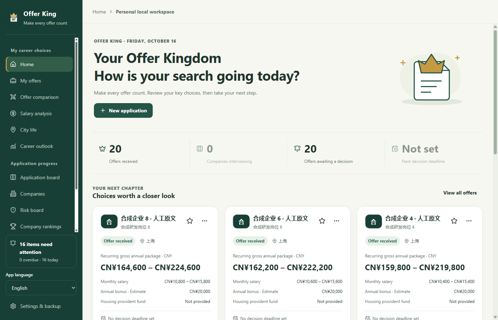

# Offer King

### Keep your applications on track. Make your next offer easier to choose.

A local-first companion for managing applications, preparing for interviews, comparing offers, and planning life in a new city. Try the Windows desktop app or the Android development trial.

**Windows 10 / 11 x64 + Android trial · Four interface languages · Local data · No app account required · Optional AI**

[简体中文](../../../README.md) · **English** · [日本語](../ja/README.md) · [한국어](../ko/README.md)

**[Windows 2.5.4 trial](https://github.com/YCC-Lover/Offer-King/releases/download/v2.5.4/Offer-King-Setup-2.5.4.exe)** · **[Android 2.5.4 trial](https://github.com/YCC-Lover/Offer-King/releases/download/v2.5.4/Offer-King-2.5.4-android-trial.apk)** · [Download guide](DOWNLOAD.md) · [AI setup](AI-SETUP.md)

> [!IMPORTANT]
> **2.5.4 is a limited trial candidate (Pre-release).** Windows has no production code signature (**NotSigned**); Android uses a **Debug development/test signature**, not a production identity. Windows clean/upgrade installation and uninstallation, and Android real-device first installation, upgrade and runtime use, have **not completed acceptance testing**. Export a backup before upgrading. If Android reports a signature conflict, stop; do not simply uninstall the existing app. No macOS, iOS or Linux installer is available. [Release notes, in Chinese](../../RELEASE-2.5.4.md)

*English UI captured from the actual 2.3.0 packaged candidate using synthetic data, at 1400 × 900 and 100% text size, with external network access blocked. The Chinese company and job names deliberately demonstrate that user content stays unchanged. New users start with an empty database. [Screenshot notes](../../images/README.md)*

## Built around your job search

- **Track several companies at once.** Move applications through stages, keep an interview timeline, and give each role a next action and date. One company can have several independent applications.
- **Type less, stay in control.** Paste one job posting in Add application, recognize explicit fields on-device, review the evidence, and fill only selected empty fields. This does not call AI or access the network.
- **Compare offers on your own terms.** Separate recurring annual compensation from first-year compensation. Use the two-offer comparison to weigh pay, growth, work–life balance, and your personal priorities.
- **Estimate take-home pay.** Explore employee social-insurance and housing-fund contributions, income tax, and 12 monthly pay rows without changing the original job's compensation.
- **Plan before moving.** Enter your own rent, commuting, living costs, and take-home cash to estimate savings. City budgets are personal estimates, not live market prices or automatic tax calculations.
- **Keep decisions grounded.** Review company information, risk research with sources, personal company rankings, and salary analysis together. Scores support your judgment; they are not objective company ratings.

*This older board screenshot is from 2.0.0 and uses synthetic data; it does not show the current English interface.*

## Start in three steps

1. **Download and verify.** Follow the [download guide](DOWNLOAD.md). You do not need GitHub login or developer tools to download the public installer.
2. **Choose a language and save your first application.** Use the language selector in the sidebar or Settings & backup → Display & readability. In Add application, enter the company and role, or paste a job posting and review the offline recognition preview. Confirm the city and stage, choose an existing company when appropriate, then create the record. Add a next action when you know what comes next.
3. **Add details as they become useful.** Record compensation, compare offers, and export a JSON backup regularly. Keep original attachment files separately.

Language changes apply immediately and are remembered on this device. Current edits remain in place; company names, job titles, notes, and custom stage names stay as written. Language settings are not part of job-data backups. AI can be configured later; local records, tasks, comparisons, and backups work without it. Older screenshots and the [detailed Chinese walkthrough](../../QUICKSTART.md) use Chinese labels.

## What is new in the 2.5.4 trial?

- **A clearly labeled trial on two platforms:** Windows and Android show platform-specific signing and acceptance-test limits in Help. Android adds a native development trial with document access and company website icons; device behavior still needs testing.
- **Windows release notifications:** with automatic checks enabled, the open, foreground app can check for a newer release once per day. You can also check manually and open the official release page. It never downloads or installs an update automatically. Users on 2.4.0 or earlier must first upgrade manually to get this feature. The Android Debug trial is not a production automatic-update recommendation.

The local tools introduced in 2.4.0 remain available:

- **Offline quick entry:** paste up to 50,000 characters for one company and role. Review recognized names, city, links, salary and supported job fields before filling empty inputs. Existing input and shared details of a reused company are not overwritten; ambiguous facts stay blank. Complete pasted text is memory-only, not part of recovery drafts or backups. No model, API key, internet access, or AI fees are needed.
- **Take-home pay:** a local CNY estimate for mainland Chinese resident employees, assuming a fixed monthly salary for 12 months with the same employer from January. Enter any city and your actual contribution bases and rates; only Beijing currently has a verified reference template, and it is applied only when you explicitly choose it. See personal contributions, tax and monthly/annual net pay. Results are estimates, not payroll or tax advice, and never write back to the job or city budget. Foreign-currency jobs are not silently converted.

The language features introduced in 2.3.0 remain available:

- **Four interface languages:** switch between 简体中文, English, 日本語, and 한국어 from the sidebar or display settings, without restarting.
- **Keep your words and edits:** changing interface language preserves current form input and stored company, application, note, and custom-stage text. Default stage labels are translated for display without rewriting stored stage names.
- **Guides in your language:** this homepage, the download guide, and the AI setup guide are available in all four languages.

The everyday features introduced in 2.2.0 remain available:

- **All reminders in one place:** overdue, today, the next seven days, later, and without a scheduled time. Completing an item creates a timeline event and clears that next action without changing its stage.
- **Recoverable drafts:** preview recovered two-offer and city-budget drafts after an unexpected exit, restore them, then explicitly save.
- **Extract pasted job descriptions:** review evidence-backed suggestions before adding them to a draft. This does not search the web or verify the source text.
- **AI configuration checks:** check the saved job model and search route after confirming quota and possible costs.

[Feature tour](../../FEATURES.md) · [Release notes](../../RELEASE-2.5.4.md) · [Changelog](../../../CHANGELOG.md)

## AI: choose when and how to use it

AI is optional. Offline quick entry and take-home-pay estimates do not use a model or incur AI fees. The app includes **no shared API key** and no promise of unlimited free cloud usage.

- To analyze a job description you already have, configure a compatible job model or a prepared local Ollama model. Search credentials are not required for this task.
- To research public information online, configure a model and the required search service. The free-start preset uses your own OpenRouter and Tavily accounts and keys; availability and quotas depend on those providers.
- Existing Bailian and DeepSeek configurations remain available. Model connections, searches, and tests may consume quota or incur charges.

Automatic research after creating a new application is off by default. AI suggestions need your review and an explicit save. [English AI setup guide](AI-SETUP.md)

## Common questions

<strong>Can I use it offline and without AI?</strong>

Yes. Local records, offline quick entry, take-home-pay estimates, application stages, timelines, reminders, comparisons, budgets, and backups do not require AI. Reminders are shown inside the app; they are not alarms that run after you close it. Website icons and AI features may access the network.

<strong>Will friends receive my applications or keys?</strong>

No. The installer does not include the author's data or keys. Everyone starts with their own local records and configures their own services. Share the installer or project link, not your personal data folder or backups.

API keys use the platform's local secure storage and are excluded from job-data JSON backups. Records, recovery drafts, and backups are not an encrypted vault. Windows attachments keep local file paths; mobile attachments use device-specific document authorization. Backup files do not contain the attachment files or transfer that authorization to another device.

Cloud text extraction sends the text you paste to your selected model. The complete pasted text is kept only in the current window's memory; accepted fields and limited evidence excerpts can remain in drafts, records, and backups. Remove private information before submitting. [Privacy details, in Chinese](../../PRIVACY.md)

<strong>What languages and platforms are available?</strong>

The 2.5.4 candidate offers Simplified Chinese, English, Japanese, and Korean on Windows 10 / 11 x64 and in the Android development trial (Android 7.0+; real-device acceptance remains pending). Switch from the navigation or display settings; the preference is stored locally and takes effect immediately. The 1100 × 700 minimum window applies only to Windows, not to Android. There are no macOS, iOS or Linux installers, portable edition, cloud sync or collaboration.

Windows 2.5.4 includes **foreground release checks and an official-release-page button**, not automatic downloading or installation. Read the [2.5.4 release page](https://github.com/YCC-Lover/Offer-King/releases/tag/v2.5.4), back up, and install manually. Version 2.4.0 and earlier need one manual upgrade before they can show the new notifications. For the Android Debug trial, follow the download guide manually; do not treat it as a production auto-update channel. GitHub Watch notifications are separate from the app.

## Feedback and sharing

[Report a bug](https://github.com/YCC-Lover/Offer-King/issues/new?template=bug_report.yml) · [Suggest a feature](https://github.com/YCC-Lover/Offer-King/issues/new?template=feature_request.yml) · [Correct a translation](https://github.com/YCC-Lover/Offer-King/issues/new?template=docs_feedback.yml)

English, Japanese, Korean, and Chinese feedback is welcome. Include your app and operating-system version, steps, expected result, and actual result. For layout issues, add language, font size, theme, and desktop scaling or phone orientation. Public Issues must not contain keys, complete backups, private attachments, or unredacted personal paths. [Feedback guide](../../../CONTRIBUTING.md) · [Private security reporting](../../../SECURITY.md)

If Offer King helps, you can Star the [project](https://github.com/YCC-Lover/Offer-King), share it with a friend, or use GitHub Watch → Releases for release notifications.

---

[中文文档中心](../../README.md) · [All releases](https://github.com/YCC-Lover/Offer-King/releases) · [License](../../../LICENSE.md) · [Third-party notices](../../../THIRD-PARTY-NOTICES.txt)

Offer King is closed-source software. This public repository contains download links, documentation, and feedback channels, not the application source code. Documentation updated 2026-10-19.
