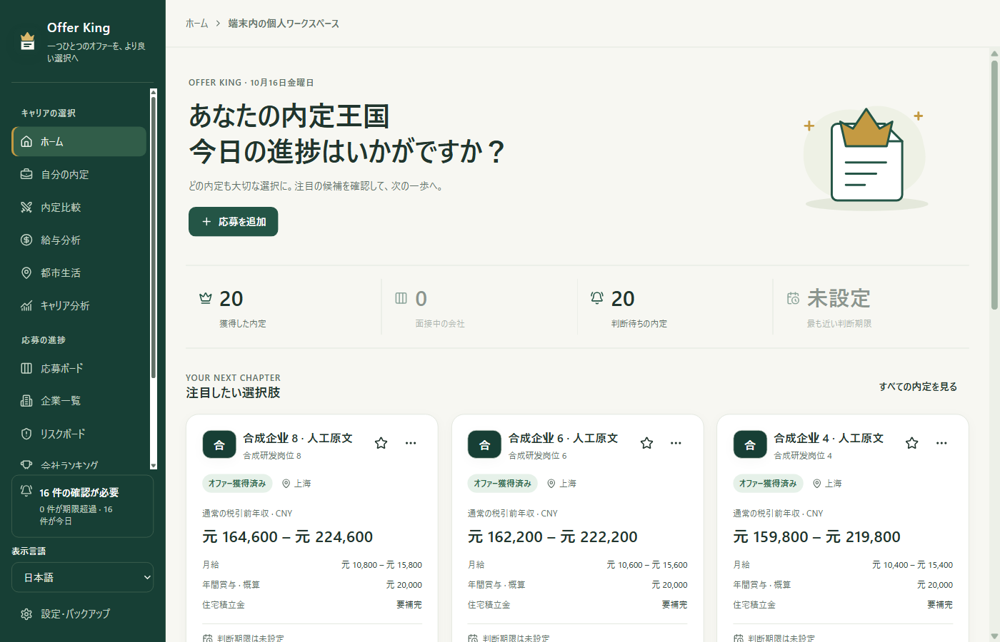

# Offer King

### 応募の進み具合を整理して、納得できるオファー選びへ。

応募管理、面接の予定、待遇の比較、転居後の生活予算まで。個人の就職・転職活動を支える、端末内保存を基本としたアプリです。Windows 版と Android 開発試用版を提供します。

**Windows 10 / 11 x64 ＋ Android 試用版 · 4 言語の UI · 端末内保存 · アカウント不要 · AI は任意**

[简体中文](../../../README.md) · [English](../en/README.md) · **日本語** · [한국어](../ko/README.md)

**[Windows 2.5.4 試用版](https://github.com/YCC-Lover/Offer-King/releases/download/v2.5.4/Offer-King-Setup-2.5.4.exe)** · **[Android 2.5.4 試用版](https://github.com/YCC-Lover/Offer-King/releases/download/v2.5.4/Offer-King-2.5.4-android-trial.apk)** · [ダウンロードガイド](DOWNLOAD.md) · [AI 設定ガイド](AI-SETUP.md)

> [!IMPORTANT]
> **2.5.4 は小規模な試用向けの候補版（Pre-release）です。** Windows は正式なコード署名なし（**NotSigned**）、Android は正式配布用ではない **Debug 開発・テスト署名**です。Windows の新規・上書きインストール・アンインストール、および Android 実機の初回・上書きインストールと利用は、**受け入れ検証未完了**です。更新前に JSON を書き出してください。Android の署名が競合したら中止し、元のアプリをそのまま削除しないでください。macOS・iOS・Linux のインストーラーはありません。[リリースノート（中国語）](../../RELEASE-2.5.4.md)

*2.3.0 のパッケージ版候補プログラムを、架空のデータ・1400 × 900・文字サイズ 100% で撮影しています。外部通信は遮断しており、中国語の企業名・職種名はユーザーの原文を保持する例です。初回は空のデータベースから始まります。[画像の出典](../../images/README.md)*

## 日々の応募管理から、最後の比較まで

- **複数の応募を見失わない。** ステージ別のボードと選考履歴で進捗を整理し、応募先ごとに次のアクションと日時を残せます。同じ企業の複数職種も別々に管理できます。
- **貼り付けて入力を減らす。** 応募の追加画面で 1 件の求人原文から明記された項目を端末内で抽出し、根拠を確認して選択した空欄だけへ入力できます。AI やネット通信は使いません。
- **待遇と自分の優先順位を比べる。** 通常年の想定年収と初年度総額を分けて表示。2 件のオファー比較で、待遇、成長、働き方などに自分の重みを付けられます。
- **手取りの見通しを立てる。** 中国本土の個人負担社会保険・住宅積立金と所得税、12 か月の手取りを試算します。元の求人の給与情報は変更しません。
- **転居後の暮らしも見通す。** 手取り、家賃、通勤費、生活費を自分で入力し、貯蓄の目安を比較できます。市況のリアルタイム相場や自動税額計算ではありません。
- **判断の根拠を残す。** 企業情報、出典付きのリスク調査、個人の企業ランキング、給与分析を確認できます。スコアは自分の判断を助けるもので、企業の客観的な格付けではありません。

*このボード画像は 2.0.0 の架空データによるものです。現在の日本語画面を示す画像ではありません。*

## まずは 3 ステップ

1. **ダウンロードしてファイルを確認。** [ダウンロードガイド](DOWNLOAD.md)に従ってください。公開インストーラーの取得に GitHub アカウントや開発ツールは不要です。
2. **言語を選んで最初の応募を保存。** サイドバー、または「設定・バックアップ → 表示・読みやすさ」で言語を選びます。「応募を追加」で企業名・職種を入力するか、求人原文を貼り付けて端末内抽出のプレビューを確認します。都市・ステージを確認し、必要に応じて既存の企業を選んで記録を作成します。次にすることが決まったら日時も追加しましょう。
3. **必要な情報から少しずつ。** 待遇が分かったら給与を入力し、比較や生活予算に活用できます。JSON を定期的に書き出し、添付ファイルの原本は別途保管してください。

言語はすぐに切り替わり、この端末に記憶します。編集中の入力は保持し、企業名・職種名・メモ・手入力のステージ名は翻訳しません。言語設定は求職データのバックアップには含めません。AI は後から設定でき、記録・予定・比較・バックアップは AI なしで利用できます。以前の画像や[詳しい操作ガイド（中国語）](../../QUICKSTART.md)では中国語の表示を使っています。

## 2.5.4 試用版の主な改善

- **2 つのプラットフォームで試用：** ヘルプに試用版表示と OS 別の署名・未検証範囲を追加しました。Android は文書アクセスや企業サイトのアイコン取得を備えた開発試用版です。実機での動作は今後の検証が必要です。
- **Windows の更新案内：** 自動チェックを有効にすると、起動中かつ前面表示時に 1 日 1 回、新バージョンを確認できます。手動確認と公式リリースページを開く操作もありますが、自動ダウンロード・インストールはしません。2.4.0 以前の版では、まず手動更新が必要です。Android の Debug 試用版を正式な自動更新経路としては推奨しません。

2.4.0 の端末内ツールも引き続き利用できます。

- **オフラインのクイック入力：** 同じ企業・職種の求人原文を最大 50,000 文字まで貼り付け、企業名、職種、都市、リンク、給与などの根拠を確認して空欄へ入力できます。既存の入力や再利用する企業の共有情報は上書きせず、不明確な情報は推測しません。全文は画面のメモリ内だけに保持し、復元用下書き・バックアップには含めません。モデル・キー・ネット接続は不要で、AI 料金もかかりません。
- **手取り給与の試算：** 中国本土の居住者個人が、1 月から同一勤務先で固定月給を 12 か月受け取る CNY 給与を端末内で試算します。都市名と実際の保険料算定基数・料率を自分で入力できます。検証済みの参考テンプレートは現在北京のみで、明示的に適用した場合だけ使います。個人負担、税額、月別・年間手取りを表示しますが、給与明細や税務助言ではありません。求人・都市予算には書き戻さず、外貨も自動換算しません。

2.3.0 の言語機能も引き続き利用できます。

- **4 言語の UI：** サイドバーや表示設定から、简体中文・English・日本語・한국어を再起動せずに切り替えられます。
- **自分の言葉と入力を保持：** 表示言語を変えても編集中の内容や企業名・職種名・メモ・独自のステージ名はそのままです。標準ステージは表示のみ翻訳し、保存済みの名前を書き換えません。
- **母語で読めるガイド：** ホーム、ダウンロード、AI 設定のガイドを 4 言語で提供します。

2.2.0 からの日常機能も引き続き利用できます。

- **すべての予定を確認：** 期限超過、今日、今後 7 日、以降、日時未設定の 5 グループ。完了すると履歴を残して次のアクションを解除し、選考ステージは変えません。
- **下書きの復元：** 予期しない終了後、オファー比較と都市別予算の下書きをプレビューして復元し、確認してから保存できます。
- **求人原文からの抽出：** 貼り付けた求人紹介から、原文の根拠を見ながら項目を採用できます。Web 検索や情報の裏付け確認は行いません。
- **AI 設定のチェック：** 保存済みの求人用モデルと検索経路を、利用枠・料金への同意後に確認できます。

[機能と画面の紹介](../../FEATURES.md) · [リリースノート](../../RELEASE-2.5.4.md) · [変更履歴](../../../CHANGELOG.md)（リンク先は中国語）

## AI は必要なときに

AI は任意機能です。オフラインのクイック入力と手取り試算ではモデルを使わず、AI 料金も発生しません。**共有 API キーは同梱されておらず、無制限の無料クラウド AI も提供していません。**

- 手元の求人原文を抽出する場合は、対応する求人用モデルか、準備済みのローカル Ollama モデルを設定します。この用途では検索キーは不要です。
- 公開情報をオンラインで調べる場合は、モデルと必要な検索機能を設定します。無料スタート設定にも、自分の OpenRouter／Tavily のアカウントとキーが必要です。利用枠や可用性は各サービスに依存します。
- 従来の百炼（Bailian）／DeepSeek 設定も使えます。モデル、検索、接続テストは利用枠を消費したり、料金が発生したりする場合があります。

応募作成後の自動調査は初期状態では無効です。AI の提案は確認して、明示的に保存してください。[日本語の AI 設定ガイド](AI-SETUP.md)

## よくある質問

<strong>AI を設定せず、オフラインでも使えますか？</strong>

はい。端末内の記録、オフラインのクイック入力、手取り試算、選考履歴、予定、比較、予算、バックアップは AI 不要です。予定の通知はアプリ内で表示するもので、終了後に動くシステムアラームではありません。企業サイトのアイコン取得や AI 機能は通信する場合があります。

<strong>友人に配ると、自分の記録も渡りますか？</strong>

インストーラーには作者の求職情報やキーは含まれません。各自の端末に自分の記録を保存し、AI も各自で設定します。共有するのはインストーラーやプロジェクトのリンクにし、個人のデータフォルダーやバックアップは渡さないでください。

API キーは各 OS の端末内セキュアストレージで保護し、求職データの JSON バックアップには含めません。通常の記録、復元用下書き、バックアップ自体は暗号化された保管庫ではありません。Windows の添付はローカルパス、モバイルの添付は端末固有の文書アクセス権を使います。JSON に添付原本は含まれず、別端末へアクセス権を移すこともできません。

クラウドモデルで原文抽出を行うと、貼り付けた文章が送信されます。全文は現在のウィンドウのメモリだけに保持しますが、**採用した項目と一部の根拠引用は下書き・記録・バックアップに残る場合があります**。送信前に個人情報を取り除いてください。[プライバシーの詳細（中国語）](../../PRIVACY.md)

<strong>日本語 UI や、Windows 以外の版はありますか？</strong>

2.5.4 候補版は Windows 10 / 11 x64 と Android 開発試用版（Android 7.0 以上、実機の受け入れ検証は未完了）で簡体字中国語・英語・日本語・韓国語に対応します。ナビゲーションや表示設定から切り替え、端末に記憶します。最小ウィンドウ 1100 × 700 は Windows のみの条件で、Android には適用しません。macOS・iOS・Linux のインストーラー、ポータブル版、クラウド同期、共同編集はありません。

Windows 2.5.4 は**前面表示中の新バージョン確認と公式ページを開くボタン**を備えますが、自動取得・インストールはしません。[2.5.4 のリリースページ](https://github.com/YCC-Lover/Offer-King/releases/tag/v2.5.4)を読み、バックアップ後に手動で更新します。2.4.0 以前は案内機能を使うためにも最初の手動更新が必要です。Android Debug 試用版はダウンロードガイドに従い手動で扱い、正式な自動更新経路とは見なさないでください。GitHub Watch はアプリの案内とは別です。

## フィードバック

[不具合の報告](https://github.com/YCC-Lover/Offer-King/issues/new?template=bug_report.yml) · [機能の提案](https://github.com/YCC-Lover/Offer-King/issues/new?template=feature_request.yml) · [翻訳の修正](https://github.com/YCC-Lover/Offer-King/issues/new?template=docs_feedback.yml)

日本語・英語・韓国語・中国語での報告を歓迎します。アプリと OS のバージョン、再現手順、期待した結果、実際の結果を書いてください。画面の問題では言語、文字サイズ、テーマ、PC の表示倍率またはスマートフォンの向きも役立ちます。Issue は公開されるため、キー、完全なバックアップ、私的な添付ファイル、個人のパスは載せないでください。[報告ガイド](../../../CONTRIBUTING.md) · [非公開のセキュリティ報告](../../../SECURITY.md)

役に立ったら、[プロジェクト](https://github.com/YCC-Lover/Offer-King)の Star や友人への紹介をどうぞ。GitHub の Watch → Releases で更新を確認できます。

---

[中文文档中心](../../README.md) · [全リリース](https://github.com/YCC-Lover/Offer-King/releases) · [利用許諾](../../../LICENSE.md) · [第三者ライセンス](../../../THIRD-PARTY-NOTICES.txt)

Offer King はクローズドソースのソフトウェアです。この公開リポジトリにはダウンロード先、説明文書、フィードバック窓口を掲載し、アプリのソースコードは公開していません。文書更新：2026-10-19。
