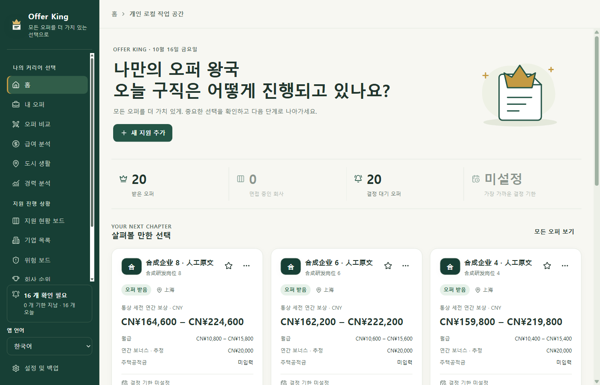

# Offer King

### 지원 현황은 한눈에, 오퍼 선택은 더 확신 있게.

지원 현황과 면접 일정을 관리하고, 처우를 비교하고, 이사 후 생활비까지 계산하는 Windows 데스크톱 취업 관리 앱입니다.

**Windows 10 / 11 · x64 · 4개 UI 언어 · 내 PC에 데이터 저장 · 앱 계정 불필요 · AI는 선택 사항**

[简体中文](../../../README.md) · [English](../en/README.md) · [日本語](../ja/README.md) · **한국어**

**[2.3.0 체험 후보 버전 다운로드](https://github.com/YCC-Lover/Offer-King/releases/download/v2.3.0/Offer-King-Setup-2.3.0.exe)** · [다운로드 안내](DOWNLOAD.md) · [AI 설정 안내](AI-SETUP.md)

> [!IMPORTANT]
> **2.3.0은 네 언어를 지원하는 체험 후보 버전(Pre-release)입니다.** 설치 파일은 서명되지 않았습니다(**NotSigned**). 실제 Windows의 새 설치·덮어쓰기 설치·제거는 **아직 인수 검증을 완료하지 않았습니다**. 업데이트 전에 백업하세요. [공개 및 검증 범위(중국어)](../../RELEASE-2.3.0.md#已验证与尚未验收)

*실제 2.3.0 패키지 후보 프로그램에서 가상 데이터로 촬영했습니다. 1400 × 900, 글자 크기 100%이며 외부 네트워크를 차단했습니다. 중국어 회사명·직무명은 사용자 원문이 유지되는 예입니다. 처음 사용하면 빈 데이터베이스에서 시작합니다. [이미지 출처](../../images/README.md)*

## 지원부터 최종 선택까지

- **여러 회사에 지원해도 놓치지 않게.** 단계별 보드와 전형 기록으로 진행 상황을 정리하고, 직무마다 다음 할 일과 시간을 남길 수 있습니다. 같은 회사의 여러 직무도 각각 관리합니다.
- **처우와 나의 우선순위를 함께 비교.** 통상 연간 보상과 첫해 총보상을 구분합니다. 두 오퍼 비교에서는 급여, 성장, 워라밸 등 나에게 중요한 항목에 직접 가중치를 줄 수 있습니다.
- **이사 후 생활까지 계획.** 세후 현금 수입, 월세, 출퇴근 비용, 생활비를 입력해 예상 저축액을 비교합니다. 실시간 지역 평균 물가나 자동 세금 계산이 아니라 개인 입력에 따른 예산입니다.
- **판단의 근거를 남기기.** 기업 정보, 출처가 있는 리스크 조사, 개인 기업 순위, 급여 분석을 함께 볼 수 있습니다. 점수는 나의 판단을 돕는 참고값이며 객관적인 기업 등급이 아닙니다.

*이 보드 이미지는 2.0.0의 가상 데이터를 사용했습니다. 2.3.0 한국어 UI는 아닙니다.*

## 세 단계로 시작하세요

1. **다운로드하고 파일 확인.** [다운로드 안내](DOWNLOAD.md)를 따라 진행하세요. 공개 설치 파일을 받는 데 GitHub 계정이나 개발 도구는 필요하지 않습니다.
2. **언어를 고르고 첫 지원 기록 저장.** 사이드바 또는 설정 및 백업 → 화면 및 가독성에서 언어를 고르세요. 지원 추가에서 회사, 직무, 도시, 단계를 입력하고 기록을 만듭니다. 다음 할 일이 정해지면 시간도 함께 적으세요.
3. **필요한 정보부터 조금씩.** 처우를 알게 되면 보상 정보를 채우고 오퍼와 생활 예산을 비교하세요. JSON 백업을 정기적으로 내보내고, 첨부 원본 파일은 따로 보관하세요.

언어는 즉시 바뀌고 이 PC에 기억합니다. 편집 중인 입력은 유지하며 회사명·직무명·메모·직접 정한 단계 이름은 번역하지 않습니다. 언어 설정은 지원 데이터 백업에 포함되지 않습니다. AI는 나중에 설정해도 되며 기록·할 일·비교·백업은 AI 없이 사용할 수 있습니다. 이전 스크린샷과 [자세한 사용법(중국어)](../../QUICKSTART.md)는 중국어 표시를 사용합니다.

## 2.3.0에서 달라진 점

- **4개 UI 언어:** 사이드바나 화면 설정에서 简体中文·English·日本語·한국어를 재시작 없이 바꿉니다.
- **입력과 원문 유지:** 표시 언어를 바꿔도 편집 내용과 회사명·직무명·메모·사용자 단계 이름은 유지합니다. 기본 단계는 표시만 번역하고 저장된 이름은 바꾸지 않습니다.
- **다국어 안내:** 홈, 다운로드, AI 설정 문서를 네 언어로 제공합니다.

2.2.0의 일상 관리 기능도 계속 사용할 수 있습니다.

- **할 일을 빠짐없이:** 기한 지남, 오늘, 앞으로 7일, 이후, 시간 미정의 다섯 그룹을 제공합니다. 완료하면 전형 기록을 남기고 다음 할 일을 지우며, 지원 단계는 바꾸지 않습니다.
- **초안 복구:** 예기치 않게 종료된 뒤 두 오퍼 비교와 도시 예산 초안을 미리 보고 복원한 다음 직접 저장할 수 있습니다.
- **채용 원문 추출:** 붙여 넣은 소개에서 원문 근거를 확인하며 항목을 선택합니다. 웹 검색이나 온라인 사실 확인은 하지 않습니다.
- **AI 설정 점검:** 사용량과 요금 안내에 동의한 뒤 저장된 직무 모델과 검색 경로를 점검합니다.

[기능과 화면 둘러보기](../../FEATURES.md) · [릴리스 노트](../../RELEASE-2.3.0.md) · [변경 이력](../../../CHANGELOG.md)(중국어)

## AI는 필요할 때 선택하세요

AI는 선택 기능입니다. **공유 API 키가 들어 있지 않으며, 무제한 무료 클라우드 AI를 제공하지 않습니다.**

- 가지고 있는 채용 원문을 추출하려면 호환 직무 모델 또는 준비된 로컬 Ollama 모델을 설정하세요. 이 작업에는 검색 키가 필요하지 않습니다.
- 공개 정보를 온라인으로 조사하려면 모델과 필요한 검색 서비스를 설정하세요. 무료 시작 프리셋도 본인의 OpenRouter·Tavily 계정과 키가 필요합니다. 제공량과 사용 가능 여부는 각 서비스에 따릅니다.
- 기존 Bailian(百炼)·DeepSeek 설정도 유지됩니다. 모델 호출, 검색, 연결 테스트는 사용량을 차감하거나 요금이 발생할 수 있습니다.

새 지원 생성 후 자동 조사는 기본적으로 꺼져 있습니다. AI 제안은 직접 확인하고 명시적으로 저장하세요. [한국어 AI 설정 안내](AI-SETUP.md)

## 자주 묻는 질문

<strong>AI 없이, 오프라인으로도 사용할 수 있나요?</strong>

네. 로컬 기록, 단계, 전형 기록, 할 일, 비교, 예산, 백업에는 AI가 필요하지 않습니다. 알림은 앱 안에서 표시되며, 앱을 닫은 뒤에도 작동하는 시스템 알람은 아닙니다. 기업 홈페이지 아이콘과 AI 기능은 인터넷을 사용할 수 있습니다.

<strong>친구에게 설치 파일을 주면 내 기록도 전달되나요?</strong>

아니요. 설치 파일에는 작성자의 지원 기록이나 키가 없습니다. 각자 PC에서 본인의 기록을 만들고 AI도 직접 설정합니다. 설치 파일이나 프로젝트 링크만 공유하고, 개인 데이터 폴더나 백업은 공유하지 마세요.

API 키는 PC에서 암호화해 보관하며 지원 데이터의 JSON 백업에 넣지 않습니다. 일반 기록, 복구 초안, 백업 자체는 암호화 금고가 아닙니다. 첨부는 파일 경로만 저장하므로 JSON 백업에 첨부 원본은 포함되지 않습니다.

클라우드 모델로 원문을 추출하면 붙여 넣은 내용이 해당 모델로 전송됩니다. 전체 원문은 현재 창의 메모리에만 있지만, **채택한 항목과 제한된 근거 발췌문은 초안·기록·백업에 남을 수 있습니다**. 전송 전에 개인정보를 지워 주세요. [개인정보 안내(중국어)](../../PRIVACY.md)

<strong>한국어 UI나 다른 운영체제도 지원하나요?</strong>

2.3.0 후보 버전은 Windows 10 / 11 x64에서 간체 중국어·영어·일본어·한국어를 지원합니다. 사이드바나 화면 설정에서 즉시 바꾸고 PC에 기억합니다. 이전 2.2.0 설치 파일은 중국어 UI 그대로입니다. 현재 macOS·Linux·모바일·포터블 버전, 클라우드 동기화, 공동 작업, 자동 업데이트는 제공하지 않습니다.

## 의견 보내기

[오류 신고](https://github.com/YCC-Lover/Offer-King/issues/new?template=bug_report.yml) · [기능 제안](https://github.com/YCC-Lover/Offer-King/issues/new?template=feature_request.yml) · [번역 수정](https://github.com/YCC-Lover/Offer-King/issues/new?template=docs_feedback.yml)

한국어·영어·일본어·중국어 의견을 환영합니다. 앱 및 Windows 버전, 재현 방법, 기대한 결과와 실제 결과를 적어 주세요. 화면 문제라면 언어, 글자 크기, 테마, Windows 배율도 도움이 됩니다. Issue는 공개되므로 키, 전체 백업, 개인 첨부, 가리지 않은 개인 경로는 올리지 마세요. [피드백 안내](../../../CONTRIBUTING.md) · [비공개 보안 신고](../../../SECURITY.md)

도움이 되었다면 [프로젝트](https://github.com/YCC-Lover/Offer-King)에 Star를 남기거나 친구에게 공유해 주세요. GitHub Watch → Releases에서 새 버전 알림을 받을 수 있습니다.

---

[中文文档中心](../../README.md) · [모든 릴리스](https://github.com/YCC-Lover/Offer-King/releases) · [사용 허가](../../../LICENSE.md) · [제3자 고지](../../../THIRD-PARTY-NOTICES.txt)

Offer King은 비공개 소스 소프트웨어입니다. 이 공개 저장소에는 다운로드 링크, 문서, 피드백 창구를 제공하며 앱 소스 코드는 공개하지 않습니다. 문서 업데이트: 2026-10-16.
